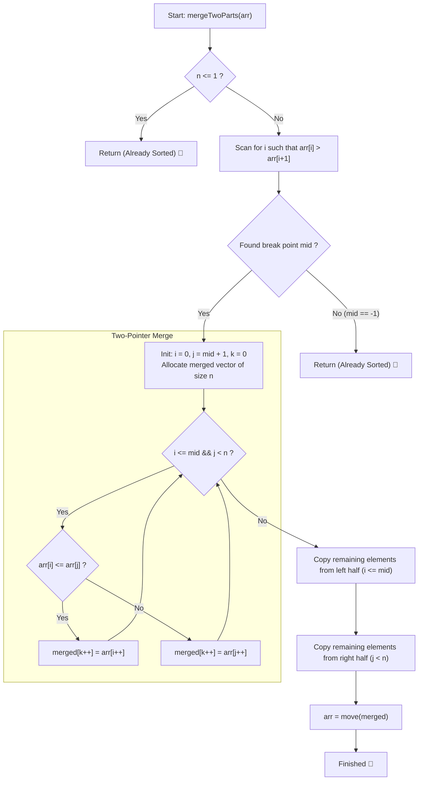

# 💡 Approach — Sort Two Parts Sorted

  | 📄 [Problem](./Problem.md) | 💡 [Approach](./Approach.md) | 🧩 [Solution](./Solution.cpp) | 🚀 [Main](./Main.cpp) |
  |:--------------------------:|:-----------------------------:|:------------------------------:|:---------------------:|

## 📊 Metadata

---

> [!TIP]
> **Core Intuition — Two Pointers Merge Over Half-Sorted Subarrays:**
> 1. **Discontinuity Point (Break Point)**:
>    The array consists of two subarrays $[0 \dots mid]$ and $[mid + 1 \dots n - 1]$, each in non-decreasing order. A single linear sweep identifies the transition where $arr[i] > arr[i + 1]$.
> 2. **Boundary Invariance**:
>    If no such index exists, the entire array is already sorted, so nothing needs to be merged. If the break point is at index $0$ or index $n - 2$, one of the subarrays has size $1$.
> 3. **Linear Two-Way Merge**:
>    With the partition boundary established, the classic two-pointer merge from Merge Sort combines both sorted segments in $\mathcal{O}(n)$ time and $\mathcal{O}(n)$ auxiliary memory.

---

## 🔩 Step-by-Step Breakdown

### Method 1: Two-Pointer Merge with Auxiliary Buffer ($\mathcal{O}(n)$ Time, $\mathcal{O}(n)$ Space) — Primary

1. **Edge Case Handling**:
   - If array length $n \le 1$, the array is already sorted; return immediately.
2. **Locate Break Point**:
   - Initialize `mid = -1`.
   - Iterate $i$ from $0$ to $n - 2$:
     - If $arr[i] > arr[i + 1]$, record `mid = i` and break.
   - If `mid == -1`, the entire array is already sorted; return directly.
3. **Merge Two Halves**:
   - Initialize pointer $i = 0$ (start of first sorted half) and pointer $j = mid + 1$ (start of second sorted half).
   - Allocate an auxiliary vector `merged` of size $n$, with insertion index $k = 0$.
   - While $i \le mid$ and $j < n$:
     - If $arr[i] \le arr[j]$, append $arr[i++]$ to `merged[k++]`.
     - Else, append $arr[j++]$ to `merged[k++]`.
4. **Flush Remaining Elements**:
   - Append any remaining elements from the first half ($i \le mid$).
   - Append any remaining elements from the second half ($j < n$).
5. **Assign Back to Original Array**:
   - Copy or move the merged array back into $arr$.

---

### Method 2: Standard In-Place Merge via Standard Library ($\mathcal{O}(n)$ Time, $\mathcal{O}(n)$ Space) — Alternative

1. **Locate Discontinuity**:
   - Find `mid` such that $arr[mid] > arr[mid + 1]$. If none exists, return.
2. **Apply `std::inplace_merge`**:
   - Execute `std::inplace_merge(arr.begin(), arr.begin() + mid + 1, arr.end())`.
   - This performs a cache-friendly merge using available auxiliary buffer.

---

## 🔄 Mermaid Flowchart

---

## 🏃‍♂️ Dry Run

### Detailed Walkthrough: Example 1 ($arr = [2, 3, 8, -1, 7, 10]$)

- **Input**: $arr = [2, 3, 8, -1, 7, 10]$, $n = 6$.
- **Break Point Search**:
  - $i = 0: arr[0] = 2 \le arr[1] = 3$
  - $i = 1: arr[1] = 3 \le arr[2] = 8$
  - $i = 2: arr[2] = 8 > arr[3] = -1 \implies mid = 2$.
- **Sorted Partitions**:
  - Left half: $arr[0 \dots 2] = [2, 3, 8]$.
  - Right half: $arr[3 \dots 5] = [-1, 7, 10]$.

| Step | Pointer $i$ | Value $arr[i]$ | Pointer $j$ | Value $arr[j]$ | Comparison | Appended Element | Resulting `merged` |
|:---:|:---:|:---:|:---:|:---:|:---:|:---:|:---|
| 1 | 0 | 2 | 3 | -1 | $2 > -1$ | $arr[j] = -1$ ($j \to 4$) | `[-1]` |
| 2 | 0 | 2 | 4 | 7 | $2 \le 7$ | $arr[i] = 2$ ($i \to 1$) | `[-1, 2]` |
| 3 | 1 | 3 | 4 | 7 | $3 \le 7$ | $arr[i] = 3$ ($i \to 2$) | `[-1, 2, 3]` |
| 4 | 2 | 8 | 4 | 7 | $8 > 7$ | $arr[j] = 7$ ($j \to 5$) | `[-1, 2, 3, 7]` |
| 5 | 2 | 8 | 5 | 10 | $8 \le 10$ | $arr[i] = 8$ ($i \to 3$) | `[-1, 2, 3, 7, 8]` |

- **Flush Remaining**:
  - Left half exhausted ($i = 3 > mid$).
  - Right half has $j = 5 \implies arr[5] = 10$ appended.
- **Final Result**: `[-1, 2, 3, 7, 8, 10]`.

---

## 📊 Complexity Analysis

| Complexity Metric | Estimation | Rationale |
| :--- | :---: | :--- |
| **Time Complexity** | $\mathcal{O}(n)$ | Finding the break point scans at most $n - 1$ adjacent pairs. The two-pointer merge processes each of the $n$ elements exactly once, yielding strict $\mathcal{O}(n)$ time. |
| **Auxiliary Space** | $\mathcal{O}(n)$ | An auxiliary vector of length $n$ stores the merged elements prior to copying back into the original array. |

---

> *"Two separated paths, each walked in perfect order, require only a singular meeting point to become one unified stride."*

---

<h3>Happy Coding! 🚀</h3>

