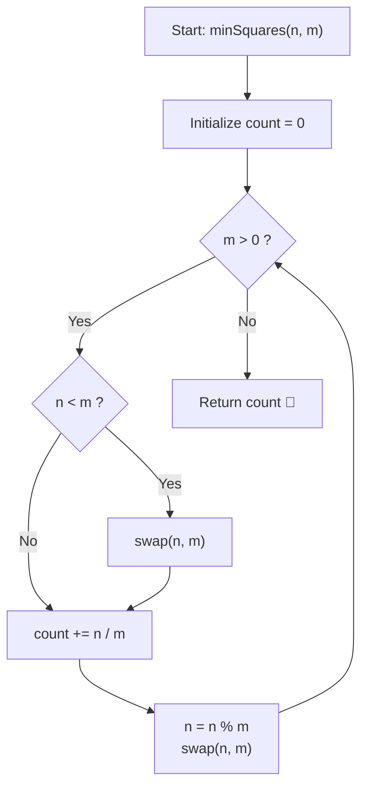

# 💡 Approach — Minimum Squares with Full Cuts

  | 📄 [Problem](./Problem.md) | 💡 [Approach](./Approach.md) | 🧩 [Solution](./Solution.cpp) | 🚀 [Main](./Main.cpp) |
  |:--------------------------:|:-----------------------------:|:------------------------------:|:---------------------:|

## 📊 Metadata

---

> [!TIP]
> **Core Intuition — Euclidean Division & Full Cut Constraint:**
> 1. **Full-Cut Geometry**:
>    Because each cut must run completely from one boundary of the paper to the opposite boundary, we can only cut parallel to one of the rectangle's sides across its entire breadth or length.
> 2. **Maximal Square Carving**:
>    Given dimensions $n$ and $m$ (assume $n \ge m$), cutting off a square of size $s \times s$ with a full cut requires $s = m$. Any cut leaving a square of side $s < m$ would leave a non-square strip that cannot be resolved without making further cuts that violate the full-cut rule or yield strictly more pieces.
> 3. **Continued Fraction Equivalence**:
>    Removing as many $m \times m$ squares as possible yields $\lfloor n / m \rfloor$ squares. The remaining rectangle is $m \times (n \pmod m)$. This process mirrors the Euclidean GCD algorithm (or continuous fraction decomposition of $n / m$).

---

## 🔩 Step-by-Step Breakdown

### Method 1: Iterative Euclidean Algorithm ($\mathcal{O}(\log(\min(n, m)))$ Time, $\mathcal{O}(1)$ Space) — Primary

1. **Orientation Normalization**:
   - At each step, if $n < m$, swap $n$ and $m$ so $n$ is always the larger side.
2. **Division & Accumulation**:
   - While $m > 0$:
     - Add $\lfloor n / m \rfloor$ to the running count of squares.
     - Update $n = n \pmod m$.
     - Swap $n$ and $m$ so the non-zero dimension becomes the new divisor.
3. **Termination**:
   - When the remainder $m$ reaches $0$, all portions of the paper have been converted into squares.
   - Return the total accumulated count.

---

### Method 2: Recursive Euclidean Algorithm ($\mathcal{O}(\log(\min(n, m)))$ Time, $\mathcal{O}(\log(\min(n, m)))$ Stack Space) — Alternative

1. **Base Case**:
   - If either dimension is $0$ ($m == 0$), return $0$.
   - If $n < m$, swap arguments: `return minSquaresRecursive(m, n)`.
2. **Recursive Transition**:
   - Add $\lfloor n / m \rfloor$ squares and recurse on the remainder:
     $$\text{ans} = \lfloor n / m \rfloor + \text{minSquaresRecursive}(m, n \pmod m)$$
3. **Return Accumulation**:
   - Unwind recursion and return total squares formed.

---

## 🔄 Mermaid Flowchart

---

## 🏃‍♂️ Dry Run

### Detailed Walkthrough: Example 1 ($n = 4, m = 5$)

- **Initial State**: $n = 4, m = 5$, `count = 0`.
- **Iteration 1**:
  - Since $n < m$, swap $\implies n = 5, m = 4$.
  - Squares added: $\lfloor 5 / 4 \rfloor = 1$. `count = 1`.
  - Remainder: $5 \pmod 4 = 1$.
  - Update: $n = 4, m = 1$.
- **Iteration 2**:
  - Squares added: $\lfloor 4 / 1 \rfloor = 4$. `count = 1 + 4 = 5`.
  - Remainder: $4 \pmod 1 = 0$.
  - Update: $n = 1, m = 0$.
- **Termination**: $m = 0 \implies$ return $5$.

---

### Detailed Walkthrough: Example 3 ($n = 11, m = 13$)

| Step | Larger ($n$) | Smaller ($m$) | Quotient $\lfloor n / m \rfloor$ | Remainder $n \pmod m$ | Squares Added | Running Total |
|:---:|:---:|:---:|:---:|:---:|:---:|:---:|
| 1 | 13 | 11 | 1 | 2 | 1 square ($11 \times 11$) | 1 |
| 2 | 11 | 2 | 5 | 1 | 5 squares ($2 \times 2$) | 6 |
| 3 | 2 | 1 | 2 | 0 | 2 squares ($1 \times 1$) | 8 |

- **Final Square Count**: $1 + 5 + 2 = 8$.

---

## 📊 Complexity Analysis

| Complexity Metric | Estimation | Rationale |
| :--- | :---: | :--- |
| **Time Complexity (Method 1)** | $\mathcal{O}(\log(\min(n, m)))$ | In each Euclidean step, the product of dimensions decreases by at least half every two steps. The worst-case runtime occurs with consecutive Fibonacci numbers, requiring at most $\approx 4.785 \log_{10}(\min(n, m))$ iterations. |
| **Time Complexity (Method 2)** | $\mathcal{O}(\log(\min(n, m)))$ | The recursion depth is identical to the Euclidean step count. |
| **Auxiliary Space (Method 1)** | $\mathcal{O}(1)$ | Constant variables (`count`, `rem`, `n`, `m`) allocated in registers. |
| **Auxiliary Space (Method 2)** | $\mathcal{O}(\log(\min(n, m)))$ | Call stack depth bounded by the logarithmic number of recursive frames. |

---

> *"When a cut must stretch uninterrupted from end to end, nature mimics the harmony of continuous fractions — yielding the golden steps of Euclidean reduction."*

---

<h3>Happy Coding! 🚀</h3>

