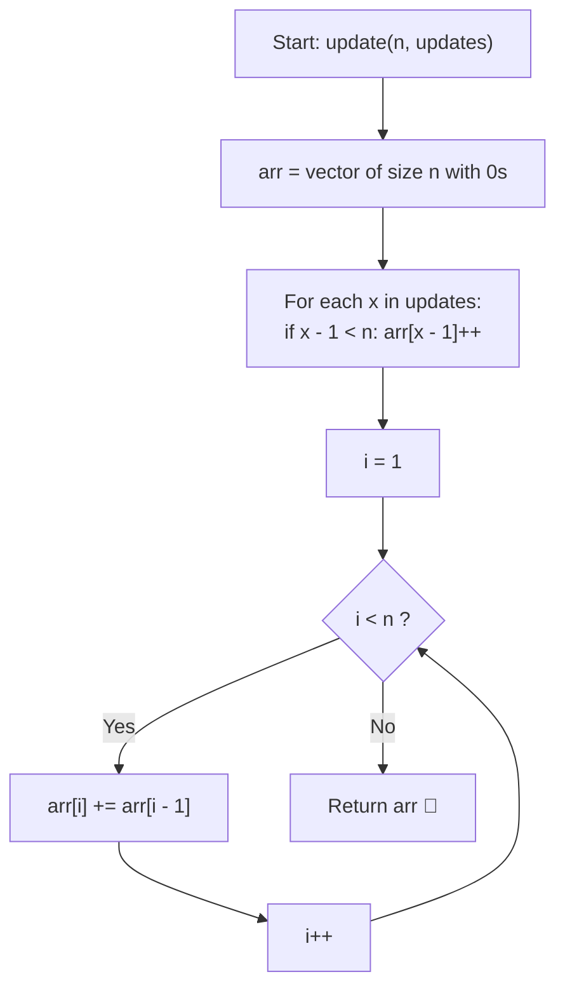

# 💡 Approach — Adding Ones

  | 📄 [Problem](./Problem.md) | 💡 [Approach](./Approach.md) | 🧩 [Solution](./Solution.cpp) | 🚀 [Main](./Main.cpp) |
  |:--------------------------:|:-----------------------------:|:------------------------------:|:---------------------:|

## 📊 Metadata

---

> [!TIP]
> **Core Intuition — Difference Array & Prefix Sum Propagation:**
> 1. **Deconstruction of Suffix Updates**:
>    Each update operation adds $1$ to all indices $i \ge j$ (1-based). In a standard difference array, adding a value $v$ across range $[L, R]$ requires $D[L] \mathrel{+}= v$ and $D[R + 1] \mathrel{-}= v$.
> 2. **Infinite Right Boundary**:
>    Because every update extends to the rightmost boundary $R = n - 1$, the decrement step at $R + 1 = n$ falls outside the array and can be omitted entirely.
> 3. **Batch Accumulation & Sweep**:
>    We first accumulate the counts of all starting points directly at $arr[j - 1]$. Afterwards, a single forward prefix sum pass calculates the true value of every index in $\mathcal{O}(n + k)$ total time, bypassing the $\mathcal{O}(n \times k)$ naive simulation.

---

## 🔩 Step-by-Step Breakdown

### Method 1: Direct Difference Array with In-Place Prefix Sum ($\mathcal{O}(n + k)$ Time, $\mathcal{O}(1)$ Auxiliary Space) — Primary

1. **Allocate Result Vector**:
   - Initialize array `arr` of size $n$ filled with $0$.
2. **Mark Increments at 0-Based Starting Indices**:
   - For each element $x \in \text{updates}$:
     - If $x - 1 < n$, increment `arr[x - 1]++`.
3. **Compute In-Place Prefix Sums**:
   - Iterate $i$ from $1$ to $n - 1$:
     - `arr[i] += arr[i - 1]`.
4. **Return Modified Array**:
   - Return `arr`.

---

### Method 2: Running Accumulator Forward Pass ($\mathcal{O}(n + k)$ Time, $\mathcal{O}(1)$ Auxiliary Space) — Alternative

1. **Count Update Frequencies**:
   - Populate frequency counts directly into `arr[x - 1]` for all $x \in \text{updates}$.
2. **Propagate with Running Sum Variable**:
   - Maintain a running sum variable `currentSum = 0`.
   - For each index $i \in [0, n - 1]$:
     - `currentSum += arr[i]`.
     - `arr[i] = currentSum`.
3. **Return Modified Array**:
   - Produces identical results while explicitly decoupling the previous read from current write.

---

## 🔄 Mermaid Flowchart

---

## 🏃‍♂️ Dry Run

### Example 1: $n = 3$, `updates = [1, 1, 2, 3]`

| Phase | Action / Index | Array State `arr` | Explanation |
| :---: | :--- | :--- | :--- |
| **Init** | Create zero array | `[0, 0, 0]` | Sized to $n = 3$ |
| **Mark 1** | Process update `1` | `[1, 0, 0]` | Index $1 - 1 = 0$ incremented |
| **Mark 2** | Process update `1` | `[2, 0, 0]` | Index $1 - 1 = 0$ incremented again |
| **Mark 3** | Process update `2` | `[2, 1, 0]` | Index $2 - 1 = 1$ incremented |
| **Mark 4** | Process update `3` | `[2, 1, 1]` | Index $3 - 1 = 2$ incremented |
| **Prefix Sweep** | $i = 1$: `arr[1] += arr[0]` | `[2, 3, 1]` | $1 + 2 = 3$ |
| **Prefix Sweep** | $i = 2$: `arr[2] += arr[1]` | `[2, 3, 4]` | $1 + 3 = 4$ |

**Final Output**: `[2, 3, 4]`

---

### Example 2: $n = 2$, `updates = [1, 1, 1]`

| Phase | Action / Index | Array State `arr` | Explanation |
| :---: | :--- | :--- | :--- |
| **Init** | Create zero array | `[0, 0]` | Sized to $n = 2$ |
| **Marks** | Process all three `1`s | `[3, 0]` | Index $0$ incremented $3$ times |
| **Prefix Sweep** | $i = 1$: `arr[1] += arr[0]` | `[3, 3]` | $0 + 3 = 3$ |

**Final Output**: `[3, 3]`

---

## 📊 Complexity Analysis

| Complexity Metric | Estimation | Rationale |
| :--- | :---: | :--- |
| **Time Complexity** | $\mathcal{O}(n + k)$ | Recording $k$ updates takes $\mathcal{O}(k)$ time; computing prefix sum takes $\mathcal{O}(n)$ time. Total $\mathcal{O}(n + k)$. |
| **Auxiliary Space** | $\mathcal{O}(1)$ | Updates and prefix sums are computed directly in the allocated return vector with no auxiliary data structures. |

---

> *"Do not redundantly walk every path to deliver repeated messages; mark the source of every ripple once, then let a single wave carry all changes to the horizon."*

---

<h3>Happy Coding! 🚀</h3>

