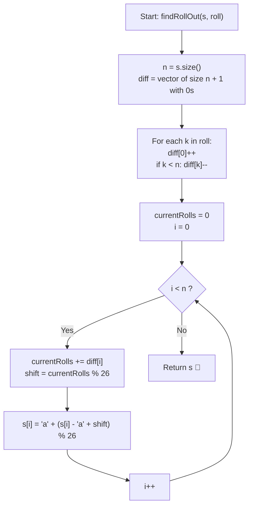

# 💡 Approach — Roll Characters of String

  | 📄 [Problem](./Problem.md) | 💡 [Approach](./Approach.md) | 🧩 [Solution](./Solution.cpp) | 🚀 [Main](./Main.cpp) |
  |:--------------------------:|:-----------------------------:|:------------------------------:|:---------------------:|

## 📊 Metadata

---

> [!TIP]
> **Core Intuition — Range Modification via Difference Array & Prefix Sum:**
> 1. **Prefix Range Shift**:
>    Each query $k \in roll$ increments characters at indices $0 \le i < k$. Directly updating $k$ characters for all $m$ queries costs $\mathcal{O}(n \times m)$ time, which is too slow when $n, m \le 10^5$.
> 2. **Difference Array Marking**:
>    In a difference array `diff` of size $n + 1$:
>    - To apply $+1$ to range $[0, k - 1]$, increment `diff[0]++` and decrement `diff[k]--`.
> 3. **Single Prefix Sum Sweep**:
>    Sweeping from index $0$ to $n - 1$ while accumulating `currentRolls += diff[i]` provides the total roll count for character $s[i]$. Character wrap-around is cleanly evaluated via modular arithmetic:
>    $$s[i] = \text{'a'} + ((s[i] - \text{'a'} + (\text{currentRolls} \pmod{26})) \pmod{26})$$

---

## 🔩 Step-by-Step Breakdown

### Method 1: Forward Difference Array & Prefix Sum ($\mathcal{O}(n + m)$ Time, $\mathcal{O}(n)$ Space) — Primary

1. **Allocate Difference Buffer**:
   - Create an integer array `diff` of size $n + 1$ initialized to $0$.
2. **Record Interval Deltas**:
   - For each prefix boundary $k \in roll$:
     - `diff[0]++`
     - If $k < n$, `diff[k]--`.
3. **Prefix Accumulation & Character Shift**:
   - Maintain a running count `currentRolls = 0`.
   - Iterate $i$ from $0$ to $n - 1$:
     - `currentRolls += diff[i]`.
     - `shift = currentRolls % 26`.
     - `s[i] = 'a' + (s[i] - 'a' + shift) % 26`.
4. **Return Result String**:
   - Return the modified string `s`.

---

### Method 2: Boundary Frequency & Suffix Accumulation ($\mathcal{O}(n + m)$ Time, $\mathcal{O}(n)$ Space) — Alternative

1. **Count Boundary Frequencies**:
   - Maintain an array `count` of size $n$ initialized to $0$.
   - For each query $k \in roll$, increment `count[k - 1]++`.
2. **Reverse Suffix Sum Sweep**:
   - Maintain `runningRolls = 0`.
   - Traverse backwards from index $n - 1$ down to $0$:
     - `runningRolls += count[i]`.
     - Shift character $s[i]$ by `runningRolls % 26`.
3. **Return Result**:
   - Achieves the exact same result by recognizing that index $i$ is covered by all prefixes of length $\ge i + 1$.

---

## 🔄 Mermaid Flowchart

---

## 🏃‍♂️ Dry Run

### Example 1: `s = "bca"`, `roll = [1, 2, 3]`, $n = 3$

| Step | Operation | `diff` / Running Rolls | String `s` State | Explanation |
| :---: | :--- | :--- | :--- | :--- |
| **0** | Initialization | `diff = [0, 0, 0, 0]` | `"bca"` | Initial string |
| **1** | $k = 1$: `[0, 0]` | `diff[0]++`, `diff[1]--` | `"bca"` | `diff = [1, -1, 0, 0]` |
| **2** | $k = 2$: `[0, 1]` | `diff[0]++`, `diff[2]--` | `"bca"` | `diff = [2, -1, -1, 0]` |
| **3** | $k = 3$: `[0, 2]` | `diff[0]++`, `diff[3]--` | `"bca"` | `diff = [3, -1, -1, -1]` |
| **4** | $i = 0$: `s[0] = 'b'` | `rolls = 3`, `shift = 3` | `'b' + 3 = 'e'` | `"eca"` |
| **5** | $i = 1$: `s[1] = 'c'` | `rolls = 3 - 1 = 2` | `'c' + 2 = 'e'` | `"eea"` |
| **6** | $i = 2$: `s[2] = 'a'` | `rolls = 2 - 1 = 1` | `'a' + 1 = 'b'` | `"eeb"` |

**Final Output**: `"eeb"`

---

### Example 2: `s = "zcza"`, `roll = [1, 1, 3, 4]`, $n = 4$

| Index $i$ | Initial Char | Boundary Deltas | Net Rolls | New Character |
| :---: | :---: | :--- | :---: | :---: |
| **0** | `'z'` | `+4` from starts at $0$ | $4$ | `'z' + 4 \to 'd'` |
| **1** | `'c'` | `diff[1] = -2` ($k=1$ ended) | $4 - 2 = 2$ | `'c' + 2 \to 'e'` |
| **2** | `'z'` | `diff[2] = 0` | $2$ | `'z' + 2 \to 'b'` |
| **3** | `'a'` | `diff[3] = -1` ($k=3$ ended) | $2 - 1 = 1$ | `'a' + 1 \to 'b'` |

**Final Output**: `"debb"`

---

## 📊 Complexity Analysis

| Complexity Metric | Estimation | Rationale |
| :--- | :---: | :--- |
| **Time Complexity** | $\mathcal{O}(n + m)$ | Recording $m$ roll operations takes $\mathcal{O}(m)$ time. Sweeping across string of length $n$ takes $\mathcal{O}(n)$ time. Total time $\mathcal{O}(n + m)$. |
| **Auxiliary Space** | $\mathcal{O}(n)$ | Difference buffer of size $n + 1$ is used to store prefix deltas. |

---

> *"To shift multiple prefixes across time, record only the moments of inception and boundary expiration; a single running wave then carries every letter to its final destination."*

---

<h3>Happy Coding! 🚀</h3>

