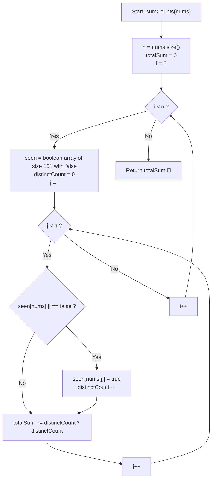

# 💡 Approach — Subarrays Distinct Element Sum of Squares I

  | 📄 [Problem](./Problem.md) | 💡 [Approach](./Approach.md) | 🧩 [Solution](./Solution.cpp) | 🚀 [Main](./Main.cpp) |
  |:--------------------------:|:-----------------------------:|:------------------------------:|:---------------------:|

## 📊 Metadata

---

> [!TIP]
> **Core Intuition — Subarray Expansion & Incremental Distinct Set Maintenance:**
> 1. **Subarray Space Bounds**:
>    Given $n \le 100$, the array contains exactly $\frac{n(n + 1)}{2} \le 5050$ total subarrays. Re-computing distinct counts from scratch for every subarray would take $\mathcal{O}(n^3)$ time, whereas incrementally extending the right boundary takes only $\mathcal{O}(n^2)$ time.
> 2. **State Re-use via Fixed Left Pointer**:
>    For a fixed starting index $i$, initializing an empty set or a boolean presence lookup table allows each increment of the right index $j$ ($i \le j < n$) to update the distinct count in $\mathcal{O}(1)$ time:
>    $$\text{distinct}_{i..j} = \text{distinct}_{i..j-1} + [nums[j] \notin nums[i..j-1]]$$
> 3. **Contribution to Total**:
>    At each step $j$, the square of the distinct count $(\text{distinct}_{i..j})^2$ is added immediately to the running total.

---

## 🔩 Step-by-Step Breakdown

### Method 1: Nested Subarray Expansion with Direct Boolean Presence Array ($\mathcal{O}(n^2)$ Time, $\mathcal{O}(\max(nums))$ Space) — Primary

1. **Initialize Accumulator**:
   - Maintain `totalSum = 0`.
2. **Iterate Subarray Starting Positions**:
   - Loop $i$ from $0$ to $n - 1$:
     - Create a boolean array `seen` of size $101$ initialized to `false` (since $1 \le nums[k] \le 100$).
     - Initialize `distinctCount = 0`.
3. **Expand Subarray Right Endpoint**:
   - Loop $j$ from $i$ to $n - 1$:
     - If `!seen[nums[j]]`:
       - `seen[nums[j]] = true`.
       - `distinctCount++`.
     - `totalSum += distinctCount * distinctCount`.
4. **Return Total**:
   - Return `totalSum`.

---

### Method 2: Incremental `unordered_set` Subarray Traversal ($\mathcal{O}(n^2)$ Time, $\mathcal{O}(n)$ Space) — Standard Alternative

1. **Initialize Accumulator**:
   - Maintain `totalSum = 0`.
2. **Hash Set Maintenance**:
   - For each start index $i$ from $0$ to $n - 1$:
     - Create an empty `unordered_set<int> distinctSet`.
     - For each end index $j$ from $i$ to $n - 1$:
       - Insert $nums[j]$ into `distinctSet`.
       - Add `distinctSet.size() * distinctSet.size()` to `totalSum`.
3. **Return Total**:
   - Generalizes cleanly to arbitrary integer values beyond $nums[k] \le 100$.

---

### Method 3: Dynamic Contribution with Last Occurrence Tracking ($\mathcal{O}(n^2)$ Time, $\mathcal{O}(n)$ Space) — Advanced Bridge to Part II

1. **Recognize Difference of Squares Expansion**:
   - When extending from index $j - 1$ to $j$ with value $v = nums[j]$, let $last = \text{lastOccurrence}[v]$.
   - For every subarray start index $k \in (last, j]$, value $v$ is newly introduced, so its distinct count increases: $c_k \leftarrow c_k + 1$.
   - The increase in square sum is $(c_k + 1)^2 - c_k^2 = 2 c_k + 1$.
2. **Incremental Running Square Maintenance**:
   - Maintain an array $c$ where $c[k]$ is the distinct count of $nums[k..j]$.
   - At each step $j$, for $k \in [last + 1, j]$, update $c[k]++$ and add $(2 c[k] - 1)$ to a running current-sum-of-squares, adding it to the grand total.
   - This concept forms the foundation of the $\mathcal{O}(n \log n)$ Segment Tree solution required for *Subarrays Distinct Element Sum of Squares II*.

---

## 🔄 Mermaid Flowchart

---

## 🏃‍♂️ Dry Run

### Example 1: `nums = [1, 2, 1]`, $n = 3$

| $i$ (Start) | $j$ (End) | Element $nums[j]$ | `seen` Table State | `distinctCount` | Added Term ($\text{count}^2$) | Running `totalSum` |
| :---: | :---: | :---: | :--- | :---: | :---: | :---: |
| **0** | **0** | $1$ | `{1: true}` | $1$ | $1^2 = 1$ | $1$ |
| **0** | **1** | $2$ | `{1: true, 2: true}` | $2$ | $2^2 = 4$ | $5$ |
| **0** | **2** | $1$ | `{1: true, 2: true}` | $2$ | $2^2 = 4$ | $9$ |
| **1** | **1** | $2$ | `{2: true}` | $1$ | $1^2 = 1$ | $10$ |
| **1** | **2** | $1$ | `{2: true, 1: true}` | $2$ | $2^2 = 4$ | $14$ |
| **2** | **2** | $1$ | `{1: true}` | $1$ | $1^2 = 1$ | $15$ |

**Final Output**: $15$

---

### Example 2: `nums = [1, 1]`, $n = 2$

| $i$ (Start) | $j$ (End) | Element $nums[j]$ | `seen` Table State | `distinctCount` | Added Term ($\text{count}^2$) | Running `totalSum` |
| :---: | :---: | :---: | :--- | :---: | :---: | :---: |
| **0** | **0** | $1$ | `{1: true}` | $1$ | $1^2 = 1$ | $1$ |
| **0** | **1** | $1$ | `{1: true}` | $1$ | $1^2 = 1$ | $2$ |
| **1** | **1** | $1$ | `{1: true}` | $1$ | $1^2 = 1$ | $3$ |

**Final Output**: $3$

---

## 📊 Complexity Analysis

| Complexity Metric | Estimation | Rationale |
| :--- | :---: | :--- |
| **Time Complexity** | $\mathcal{O}(n^2)$ | The outer loop runs $n$ times; the inner loop runs $n - i$ times. Across all pairs $(i, j)$, checking and setting a flat boolean array takes $\mathcal{O}(1)$ time, yielding $\sum_{i=1}^n i = \frac{n(n + 1)}{2} = \mathcal{O}(n^2)$ total operations. |
| **Auxiliary Space** | $\mathcal{O}(\max(nums))$ or $\mathcal{O}(1)$ | The boolean array has a fixed capacity of $101$, consuming negligible $\mathcal{O}(1)$ additional memory. |

---

> *"By expanding subarrays from a common anchor, each new element only needs to declare whether it has spoken before; the distinct count grows monotonically, and the squares sum effortlessly."*

---

<h3>Happy Coding! 🚀</h3>

