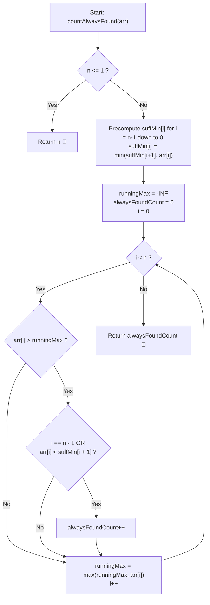

# 💡 Approach — Successful Binary Searches Irrespective of Pivot

  | 📄 [Problem](./Problem.md) | 💡 [Approach](./Approach.md) | 🧩 [Solution](./Solution.cpp) | 🚀 [Main](./Main.cpp) |
  |:--------------------------:|:-----------------------------:|:------------------------------:|:---------------------:|

## 📊 Metadata

---

> [!TIP]
> **Core Intuition — Bilateral Partition Invariant (Prefix Max & Suffix Min):**
> 1. **Adversarial Pivot Choice**:
>    The pivot sequence is arbitrary and may be adversarial. For a target at index $i$ to be guaranteed to be found, every possible pivot comparison inside any valid range $[lo, hi]$ containing $i$ must narrow the window without eliminating $i$.
> 2. **Left-Side Necessary Condition**:
>    If there exists any index $p < i$ such that $arr[p] > arr[i]$, an adversary can select $p$ on the initial step. Because $target < arr[p]$, the search algorithm sets $hi = p - 1 < i$, permanently excluding $i$. Hence, we must have:
>    $$\forall p < i, \quad arr[p] < arr[i] \iff arr[i] > \max_{0 \le j < i} arr[j]$$
> 3. **Right-Side Necessary Condition**:
>    Similarly, if there exists any index $p > i$ such that $arr[p] < arr[i]$, choosing $p$ sets $lo = p + 1 > i$, permanently excluding $i$. Hence:
>    $$\forall p > i, \quad arr[p] > arr[i] \iff arr[i] < \min_{i < j < n} arr[j]$$
> 4. **Sufficiency**:
>    If both conditions hold, any pivot $p < i$ yields $arr[p] < arr[i] \implies lo = p + 1 \le i$, and any pivot $p > i$ yields $arr[p] > arr[i] \implies hi = p - 1 \ge i$. The window $[lo, hi]$ continues to contain index $i$ at every step until $p = i$ is selected. Thus, the condition is both necessary and sufficient.

---

## 🔩 Step-by-Step Breakdown

### Method 1: Suffix Minimum Precomputation with Running Prefix Max ($\mathcal{O}(n)$ Time, $\mathcal{O}(n)$ Space) — Primary

1. **Precompute Suffix Minimums**:
   - Create an array `suffMin` of size $n$.
   - Set `suffMin[n - 1] = arr[n - 1]`.
   - Traverse backwards from index $n - 2$ down to $0$:
     $$\text{suffMin}[i] = \min(\text{suffMin}[i + 1], arr[i])$$
2. **Forward Sweep with Running Maximum**:
   - Initialize `runningMax = INT_MIN` and `alwaysFoundCount = 0`.
   - For each index $i$ from $0$ to $n - 1$:
     - Check if $arr[i] > \text{runningMax}$ (valid left partition).
     - Check if $i == n - 1$ or $arr[i] < \text{suffMin}[i + 1]$ (valid right partition).
     - If both hold, increment `alwaysFoundCount++`.
     - Update $\text{runningMax} = \max(\text{runningMax}, arr[i])$.
3. **Return Result**:
   - Return `alwaysFoundCount`.

---

### Method 2: Dual Prefix-Max and Suffix-Min Arrays ($\mathcal{O}(n)$ Time, $\mathcal{O}(n)$ Space) — Explicit Symmetry

1. **Build `prefMax`**:
   - `prefMax[0] = arr[0]`.
   - For $i = 1 \dots n - 1$: `prefMax[i] = max(prefMax[i - 1], arr[i])`.
2. **Build `suffMin`**:
   - `suffMin[n - 1] = arr[n - 1]`.
   - For $i = n - 2 \dots 0$: `suffMin[i] = min(suffMin[i + 1], arr[i])`.
3. **Filter Elements**:
   - For each index $i$:
     - Left condition: $i == 0 \lor arr[i] > \text{prefMax}[i - 1]$.
     - Right condition: $i == n - 1 \lor arr[i] < \text{suffMin}[i + 1]$.
     - If both conditions hold, increment count.

---

### Method 3: Boolean Candidate Filter ($\mathcal{O}(n)$ Time, $\mathcal{O}(n)$ Space) — Modular Pass

1. **Left-to-Right Pass**:
   - Initialize `vector<bool> candidate(n, false)`.
   - Track `maxSoFar = INT_MIN`. If $arr[i] > \text{maxSoFar}$, set `candidate[i] = true` and update `maxSoFar`.
2. **Right-to-Left Pass**:
   - Track `minSoFar = INT_MAX`.
   - If $arr[i] < \text{minSoFar}$:
     - If `candidate[i]` is `true`, increment total count.
     - Update `minSoFar = arr[i]`.
3. **Return Count**:
   - Yields an identical answer while visually decoupling the left and right constraints.

---

## 🔄 Mermaid Flowchart

---

## 🏃‍♂️ Dry Run

### Example 1: `arr = [3, 7, 9, 8, 15]` ($n = 5$)

1. **Suffix Minimum Table**:
   - `suffMin[4] = 15`
   - `suffMin[3] = min(15, 8) = 8`
   - `suffMin[2] = min(8, 9) = 8`
   - `suffMin[1] = min(8, 7) = 7`
   - `suffMin[0] = min(7, 3) = 3`

2. **Sequential Trace**:

| Index $i$ | $arr[i]$ | `runningMax` before | Left Check ($> \text{max}$) | Right Check ($< \text{suffMin}[i+1]$) | Valid? | `runningMax` after | `count` |
| :---: | :---: | :---: | :---: | :---: | :---: | :---: | :---: |
| **0** | $3$ | $-\infty$ | $3 > -\infty$ ✅ | $3 < \text{suffMin}[1] (7)$ ✅ | **Yes** | $3$ | **1** |
| **1** | $7$ | $3$ | $7 > 3$ ✅ | $7 < \text{suffMin}[2] (8)$ ✅ | **Yes** | $7$ | **2** |
| **2** | $9$ | $7$ | $9 > 7$ ✅ | $9 < \text{suffMin}[3] (8)$ ❌ | **No** | $9$ | **2** |
| **3** | $8$ | $9$ | $8 > 9$ ❌ | — | **No** | $9$ | **2** |
| **4** | $15$ | $9$ | $15 > 9$ ✅ | Last element ✅ | **Yes** | $15$ | **3** |

**Final Result**: `3` (Indices 0, 1, 4).

---

### Example 2: `arr = [9, 4, 1, 10, 22, 23, 20]` ($n = 7$)

| Index $i$ | $arr[i]$ | Prefix Max Before | Left OK? | Suffix Min After | Right OK? | Status |
| :---: | :---: | :---: | :---: | :---: | :---: | :---: |
| **0** | $9$ | $-\infty$ | ✅ | $\min(4, 1, \dots) = 1$ | ❌ ($9 \not< 1$) | Discarded |
| **1** | $4$ | $9$ | ❌ ($4 \not> 9$) | — | — | Discarded |
| **2** | $1$ | $9$ | ❌ ($1 \not> 9$) | — | — | Discarded |
| **3** | $10$ | $9$ | ✅ ($10 > 9$) | $\min(22, 23, 20) = 20$ | ✅ ($10 < 20$) | **Valid (Count = 1)** |
| **4** | $22$ | $10$ | ✅ ($22 > 10$) | $\min(23, 20) = 20$ | ❌ ($22 \not< 20$) | Discarded |
| **5** | $23$ | $22$ | ✅ ($23 > 22$) | $\min(20) = 20$ | ❌ ($23 \not< 20$) | Discarded |
| **6** | $20$ | $23$ | ❌ ($20 \not> 23$) | Last element | ✅ | Discarded |

**Final Result**: `1` (Index 3, element 10).

---

## 📊 Complexity Analysis

| Complexity Metric | Estimation | Rationale |
| :---: | :---: | :--- |
| **Time Complexity** | $\mathcal{O}(n)$ | Precomputing the suffix minimum takes a single backward pass of $n$ steps. The evaluation loop takes a single forward pass of $n$ steps, performing constant-time comparisons per element. Total operations: $2n \in \mathcal{O}(n)$. |
| **Auxiliary Space** | $\mathcal{O}(n)$ | We allocate a single array `suffMin` of size $n$ to store suffix minimums. All other variables (`runningMax`, `count`, loop counter) consume $\mathcal{O}(1)$ scalar storage. |

---

> *"A true leader maintains perfect order in both directions — surpassing all who came before, and staying humble before all who come after."*

---

<h3>Happy Coding! 🚀</h3>

