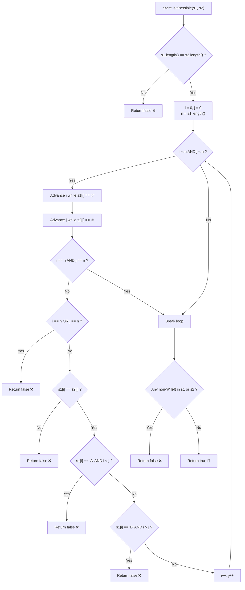

# 💡 Approach — Convert One String to Another with Constraints

  | 📄 [Problem](./Problem.md) | 💡 [Approach](./Approach.md) | 🧩 [Solution](./Solution.cpp) | 🚀 [Main](./Main.cpp) |
  |:--------------------------:|:-----------------------------:|:------------------------------:|:---------------------:|

## 📊 Metadata

---

> [!TIP]
> **Core Intuition — Two-Pointer Directional Invariant:**
> 1. **Length Compatibility**:
>    Because operations only swap characters within $s1$, transformations cannot change string length. Hence, if $s1.\text{length}() \neq s2.\text{length}()$, transformation is instantly impossible.
> 2. **Relative Order Invariant**:
>    Characters `'A'` and `'B'` are impermeable barriers to each other and cannot leapfrog identical characters. Stripping all empty buffer markers (`'#'`) must leave an identical sequence of non-empty characters in both strings.
> 3. **Unidirectional Shift Verification**:
>    For each matching $k$-th non-empty character at original index $i$ in $s1$ and target index $j$ in $s2$:
>    - If the character is `'A'`, it can only drift **leftward**, requiring $i \ge j$.
>    - If the character is `'B'`, it can only drift **rightward**, requiring $i \le j$.
>    Any violation of these conditions certifies that the target configuration is unreachable.

---

## 🔩 Step-by-Step Breakdown

### Method 1: Two-Pointer Monotonic Scan ($\mathcal{O}(n + m)$ Time, $\mathcal{O}(1)$ Space) — Primary

1. **Length Check**:
   - Let $n = s1.\text{length}()$ and $m = s2.\text{length}()$.
   - If $n \neq m$, return `false`.
2. **Synchronized Scanning**:
   - Initialize two pointers $i = 0$ (for $s1$) and $j = 0$ (for $s2$).
   - Loop while $i < n$ and $j < m$:
     - Advance $i$ while $i < n$ and $s1[i] == '\#'$.
     - Advance $j$ while $j < m$ and $s2[j] == '\#'$.
     - If both reach the end ($i == n$ and $j == m$), break out successfully.
     - If only one pointer exhausts its string ($i == n$ or $j == m$), counts of non-`'#'` mismatch $\implies$ return `false`.
     - Compare characters: if $s1[i] \neq s2[j]$, relative orders mismatch $\implies$ return `false`.
     - Check directional movement:
       - If $s1[i] == 'A'$ and $i < j$, `'A'` must move right $\implies$ return `false`.
       - If $s1[i] == 'B'$ and $i > j$, `'B'` must move left $\implies$ return `false`.
     - Increment both pointers: $i++$ and $j++$.
3. **Trailing Empty Characters Check**:
   - Ensure any remaining characters in $s1$ and $s2$ are strictly `'#'`.
   - If non-`'#'` characters remain, return `false`.
4. **Final Return**:
   - Return `true`.

---

### Method 2: Indexed Character Extraction ($\mathcal{O}(n + m)$ Time, $\mathcal{O}(n + m)$ Space) — Array Filtering

1. **Collect Non-Empty Tokens**:
   - Traverse $s1$ and collect pairs $(s1[i], i)$ for all $s1[i] \neq '\#'$.
   - Traverse $s2$ and collect pairs $(s2[j], j)$ for all $s2[j] \neq '\#'$.
2. **Compare Sequences**:
   - If the lengths of the collected vectors differ, return `false`.
   - For each index $k \in [0, \text{size} - 1]$:
     - Check if character $s1[k] == s2[k]$.
     - Check if directional constraints hold ($i \ge j$ for `'A'`, $i \le j$ for `'B'`).
3. **Trade-off**:
   - Simpler to reason about, but consumes $\mathcal{O}(n)$ auxiliary memory instead of $\mathcal{O}(1)$.

---

### Method 3: State-Space BFS Simulation ($\mathcal{O}(V + E)$ Time, Exponential Space) — Conceptual Verification

1. **Graph Exploration**:
   - Treat each configuration of string $s1$ as a graph vertex.
   - For tiny strings ($n \le 8$), generate all adjacent reachable states via valid swaps with `'#'`.
   - A standard BFS confirms connectivity from $s1$ to $s2$.

---

## 🔄 Mermaid Flowchart

---

## 🏃‍♂️ Dry Run

### Example 1: `s1 = "#A#B#B#"`, `s2 = "A###B#B"` ($n = 7$)

| Step | Pointer $i$ (`s1`) | Pointer $j$ (`s2`) | $s1[i]$ | $s2[j]$ | Match? | Constraint Rule | Valid? | Action |
| :---: | :---: | :---: | :---: | :---: | :---: | :---: | :---: | :---: |
| **1** | $1$ (`A`) | $0$ (`A`) | `'A'` | `'A'` | Yes | `'A'` moves left $\implies i \ge j$ ($1 \ge 0$) | Valid | $i \leftarrow 2, j \leftarrow 1$ |
| **2** | $3$ (`B`) | $4$ (`B`) | `'B'` | `'B'` | Yes | `'B'` moves right $\implies i \le j$ ($3 \le 4$) | Valid | $i \leftarrow 4, j \leftarrow 5$ |
| **3** | $5$ (`B`) | $6$ (`B`) | `'B'` | `'B'` | Yes | `'B'` moves right $\implies i \le j$ ($5 \le 6$) | Valid | $i \leftarrow 6, j \leftarrow 7$ |
| **4** | $7$ (End) | $7$ (End) | — | — | — | Both exhausted | Valid | Loop exits |

**Final Result**: `true`.

---

### Example 2: `s1 = "#A#B#"`, `s2 = "#B#A#"` ($n = 5$)

| Step | Pointer $i$ (`s1`) | Pointer $j$ (`s2`) | $s1[i]$ | $s2[j]$ | Match? | Constraint Rule | Result |
| :---: | :---: | :---: | :---: | :---: | :---: | :---: | :---: |
| **1** | $1$ (`A`) | $1$ (`B`) | `'A'` | `'B'` | **Mismatch!** | `'A'` cannot equal `'B'` | Return `false` |

**Final Result**: `false`.

---

## 📊 Complexity Analysis

| Complexity Metric | Estimation | Rationale |
| :---: | :---: | :--- |
| **Time Complexity** | $\mathcal{O}(n + m)$ | Each string pointer $i$ and $j$ moves forward monotonically from index $0$ to $n$. Every character in $s1$ and $s2$ is inspected at most once during the skipping of spaces or constraint verification. |
| **Auxiliary Space** | $\mathcal{O}(1)$ | The two-pointer approach operates directly on input strings using only integer indices $i, j, n, m$. No additional arrays, lists, or heap structures are allocated. |

---

> *"When rigid constraints bind every step, verifying global reachability requires only that we protect the immutable order and respect the direction of the flow."*

---

<h3>Happy Coding! 🚀</h3>

