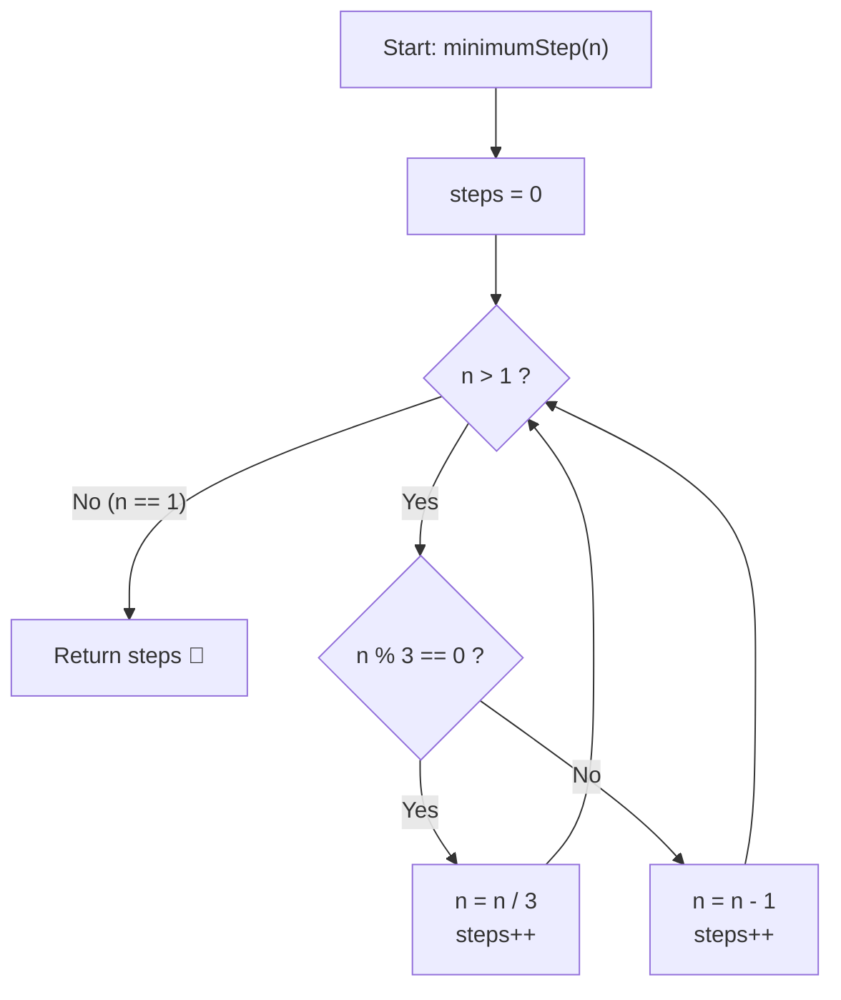

# 💡 Approach — Shortest Path From 1 To n

  | 📄 [Problem](./Problem.md) | 💡 [Approach](./Approach.md) | 🧩 [Solution](./Solution.cpp) | 🚀 [Main](./Main.cpp) |
  |:--------------------------:|:-----------------------------:|:------------------------------:|:---------------------:|

## 📊 Metadata

---

> [!TIP]
> **Core Intuition — Reverse Direction Greedy Paradigm:**
> 1. **Direction Reversal Invariant**:
>    Moving forward from $1 \to n$ allows two moves at each vertex $i$: increment ($i + 1$) or tripling ($3 \times i$). This generates a dense branch tree where finding the shortest path without extra memory is intractable. However, traversing **backwards from $n \to 1$** yields strict inverse operations:
>    - If $n$ is divisible by $3$, we can transition to $n / 3$.
>    - In all cases, we can transition to $n - 1$.
> 2. **Optimal Substructure & Greedy Choice Property**:
>    Whenever $n$ is a multiple of $3$ ($n = 3k$), choosing $n \to n / 3 = k$ consumes $1$ edge and reduces the value by $2k$. Choosing $n - 1$ instead reaches $3k - 1$, which requires at least two further decrements before another division is possible, landing on $k - 1$ after $4$ edges. Because $k < 3k - 1$, dividing by $3$ always strictly dominates or matches any decrement strategy.
> 3. **Logarithmic Bound**:
>    Since any integer $n$ can be decremented at most twice before becoming a multiple of $3$, $n$ is divided by $3$ at least once every three steps. Thus, $n$ reaches $1$ in at most $3 \log_3(n)$ operations ($\le 55$ iterations for $n = 10^8$).

---

## 🔩 Step-by-Step Breakdown

### Method 1: Reverse Greedy Simulation ($\mathcal{O}(\log_3 n)$ Time, $\mathcal{O}(1)$ Space) — Primary

1. **Initialize Operation Counter**:
   - Set `steps = 0`.
2. **Reverse Iteration**:
   - While $n > 1$:
     - Check if $n$ is evenly divisible by $3$ ($n \pmod 3 == 0$):
       - If true, divide $n$ by $3$: $n \leftarrow n / 3$.
     - Otherwise, $n$ is not divisible by $3$:
       - Decrement $n$ by $1$: $n \leftarrow n - 1$.
     - Increment `steps` by $1$.
3. **Return**:
   - When $n$ equals $1$, return `steps`.

---

### Method 2: Chunked Modulo Arithmetic ($\mathcal{O}(\log_3 n)$ Time, $\mathcal{O}(1)$ Space) — Block Jumps

Instead of decrementing one unit at a time, we can consume the remainder modulo $3$ in a single batch operation:

1. **Check Base Threshold**:
   - If $n < 3$, the answer is simply $n - 1$ (for $n = 1 \implies 0$, for $n = 2 \implies 1$).
2. **Batch Modulo Steps**:
   - If $n \pmod 3 == 0$, divide $n \leftarrow n / 3$ and increment `steps` by $1$.
   - If $n \pmod 3 \neq 0$, add $n \pmod 3$ directly to `steps`, and set $n \leftarrow n - (n \pmod 3)$.
   - Repeat until $n \le 1$.
3. **Complexity**:
   - Identical asymptotic complexity, requiring roughly half the loop iterations.

---

### Method 3: Breadth-First Search (BFS) ($\mathcal{O}(V + E)$ Time, $\mathcal{O}(V)$ Space) — Forward Shortest Path

1. **Queue Initialization**:
   - Push pair `(1, 0)` into a queue and mark vertex $1$ as visited in a hash set or boolean array.
2. **Level-Order Expansion**:
   - Pop `(curr, dist)`:
     - If `curr == n`, return `dist`.
     - Push `(curr + 1, dist + 1)` if $\le n$ and unvisited.
     - Push `(3 * curr, dist + 1)` if $\le n$ and unvisited.
3. **Limitations**:
   - Practical only for small $n \le 10^5$. For $n = 10^8$, memory and time exceed limits ($\approx 10^8$ states). Used primarily for test validation.

---

## 📐 Mathematical Proof of Optimality

Let $OPT(x)$ be the minimum number of steps to reach $x$ from $1$ (or equivalently, from $x$ to $1$ in reverse).

**Theorem**: For any $n = 3k$ where $k \ge 1$:
$$OPT(3k) = 1 + OPT(k)$$

*Proof*:
In reverse, from $3k$, the available moves are:
1. Move to $k$ in $1$ step. Total steps $= 1 + OPT(k)$.
2. Move to $3k - 1$ in $1$ step. From $3k - 1$, since $\gcd(3k - 1, 3) = 1$, the only reverse move is to decrement:
   $$3k - 1 \xrightarrow{-1} 3k - 2 \xrightarrow{-1} 3k - 3 = 3(k - 1) \xrightarrow{/3} k - 1$$
   This path requires $1 + 1 + 1 + 1 = 4$ steps to reach $k - 1$.
   However, from $k$, we can reach $k - 1$ in just $1$ step ($k \xrightarrow{-1} k - 1$).
   Thus, starting with division takes $1 + 1 = 2$ steps to reach $k - 1$, whereas decrementing takes $4$ steps to reach the same state $k - 1$.
   Since $OPT(k) \le OPT(3k - 1)$, the choice $n \leftarrow n / 3$ strictly dominates $n \leftarrow n - 1$. $\blacksquare$

---

## 🔄 Mermaid Flowchart

---

## 🔍 Step-by-Step Trace Example

### Trace for $n = 15$:

| Iteration | Current $n$ | Condition | Action | Next $n$ | Accumulated `steps` |
| :---: | :---: | :---: | :---: | :---: | :---: |
| 1 | **15** | $15 \pmod 3 == 0$ | Divide by 3 ($15 / 3$) | 5 | 1 |
| 2 | **5** | $5 \pmod 3 == 2$ | Decrement ($5 - 1$) | 4 | 2 |
| 3 | **4** | $4 \pmod 3 == 1$ | Decrement ($4 - 1$) | 3 | 3 |
| 4 | **3** | $3 \pmod 3 == 0$ | Divide by 3 ($3 / 3$) | 1 | 4 |
| 5 | **1** | $n \le 1$ | Terminate loop | 1 | **4** |

**Forward Path Reconstructed**: $1 \xrightarrow{\times 3} 3 \xrightarrow{+1} 4 \xrightarrow{+1} 5 \xrightarrow{\times 3} 15$ (Length = 4 edges).

---

## 📊 Complexity Analysis

| Complexity Metric | Estimation | Rationale |
| :---: | :---: | :--- |
| **Time Complexity** | $\mathcal{O}(\log_3 n)$ | At each step, either $n$ is divided by $3$, or decremented by $1$. At most two consecutive decrements occur before $n$ becomes a multiple of $3$. Thus, the loop runs at most $3 \log_3(n) \le 55$ times for $n = 10^8$. |
| **Auxiliary Space** | $\mathcal{O}(1)$ | Only a single integer variable (`steps`) is used. No recursion, arrays, or heap memory allocations are involved. |

---

> *"When a path forward offers dizzying branches, walking backward from the destination transforms chaos into clarity."*

---

<h3>Happy Coding! 🚀</h3>

