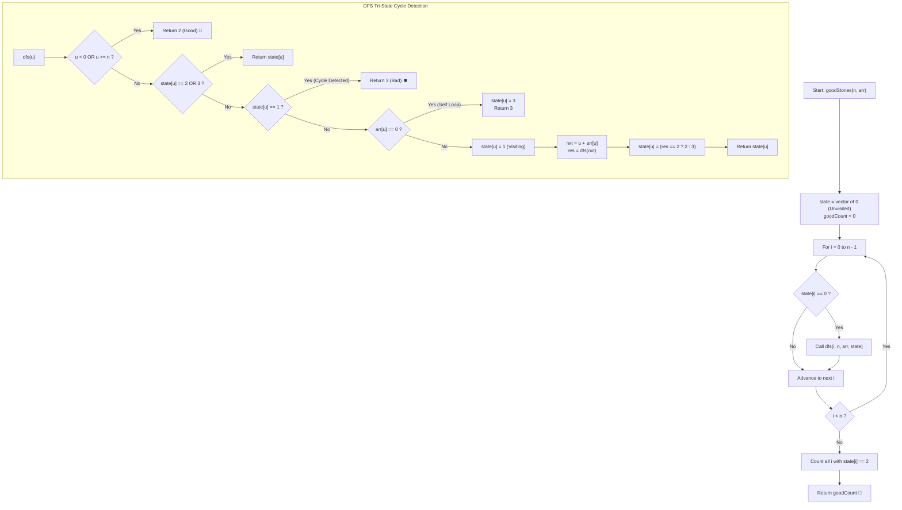

# 💡 Approach — Count Indices That Escape Array

  | 📄 [Problem](./Problem.md) | 💡 [Approach](./Approach.md) | 🧩 [Solution](./Solution.cpp) | 🚀 [Main](./Main.cpp) |
  |:--------------------------:|:-----------------------------:|:------------------------------:|:---------------------:|

## 📊 Metadata

---

> [!TIP]
> **Core Intuition — Functional Graph Topology & Tri-State Cycle Memoization:**
> 1. **Functional Graph Invariant**:
>    Because each index $i \in [0, n - 1]$ has at most one fixed transition $nxt = i + arr[i]$, the entire jump system forms a directed **functional graph** (also known as a successor graph). In such graphs, the out-degree of every internal vertex is exactly $1$.
> 2. **Canonical Graph Decomposition**:
>    Every connected component in a finite functional graph consists of:
>    - A set of directed trees whose edges lead into a **directed cycle** (trapped states that loop infinitely).
>    - A set of directed trees whose edges lead to an **absorbing boundary state** (escaping outside $[0, n - 1]$).
> 3. **Tri-State Classification**:
>    To classify all vertices in $\mathcal{O}(n)$ time without re-evaluating shared paths, we track 4 explicit status flags in an auxiliary array `state[]`:
>    - `0` (**UNVISITED**): Node has not yet been processed.
>    - `1` (**VISITING**): Node is currently in the active recursion call stack. Reaching a node with `state == 1` indicates back-edge detection (a cycle).
>    - `2` (**GOOD**): Node leads out of bounds (escapes).
>    - `3` (**BAD**): Node leads into a cycle, a $0$-jump self-loop, or a known trapped node.

---

## 🔩 Step-by-Step Breakdown

### Method 1: Tri-State DFS with Memoization ($\mathcal{O}(n)$ Time, $\mathcal{O}(n)$ Space) — Primary

1. **State Array Allocation**:
   - Create `vector<int> state(n, 0)` where `0` denotes unvisited.
2. **Recursive Traversal Definition `dfs(u)`**:
   - **Boundary Condition (Good)**: If $u < 0$ or $u \ge n$, we have escaped array bounds. Return status `2` (Good).
   - **Memoized Terminal State**: If `state[u] == 2` or `state[u] == 3`, return `state[u]` immediately.
   - **Cycle Detection (Bad)**: If `state[u] == 1`, we hit a back-edge in the current call stack. Mark `state[u] = 3` and return `3` (Bad).
   - **Self-Loop Check**: If $arr[u] == 0$, $u + arr[u] = u$. It is a dead-end self-loop. Mark `state[u] = 3` and return `3`.
   - **Active Traversal**: Mark `state[u] = 1` (Visiting).
   - **Recursive Step**: Compute next index $nxt = u + arr[u]$. Let `res = dfs(nxt)`.
   - **Memoize & Propagate**: Set `state[u] = (res == 2) ? 2 : 3`. Return `state[u]`.
3. **Aggregate Count**:
   - Iterate $i$ from $0$ to $n - 1$. If `state[i] == 0`, invoke `dfs(i)`.
   - Count all indices where `state[i] == 2`.

---

### Method 2: Non-Recursive Iterative Path Traversal ($\mathcal{O}(n)$ Time, $\mathcal{O}(n)$ Space) — Stack-Safe

To guarantee absolute immunity against stack overflow on platforms with strict stack depth limits on $n = 10^5$:

1. For each index $i \in [0, n - 1]$, if `state[i] != 0`, continue.
2. Initialize a local vector `path` and trace jump pointers:
   - While the current pointer $curr \in [0, n - 1]$ and `state[curr] == 0`:
     - Mark `state[curr] = 1` (Visiting).
     - Add `curr` to `path`.
     - Move $curr \leftarrow curr + arr[curr]$.
3. Determine final status of the path:
   - If $curr < 0$ or $curr \ge n$ or `state[curr] == 2`: All indices in `path` escape $\implies$ mark all as `2` (Good).
   - If $curr$ is inside bounds and (`state[curr] == 1` or `state[curr] == 3`): A cycle or trapped path is detected $\implies$ mark all as `3` (Bad).
4. Accumulate all nodes with `state == 2`.

---

### Method 3: Reverse Multi-Source BFS from Out-of-Bounds ($\mathcal{O}(n)$ Time, $\mathcal{O}(n)$ Space) — Structural Dual

1. Construct the **transpose (reverse) graph** $G^R$:
   - For each index $i \in [0, n - 1]$, let $nxt = i + arr[i]$.
   - If $0 \le nxt < n$, add directed edge $nxt \to i$ in $G^R$.
   - If $nxt < 0$ or $nxt \ge n$, index $i$ escapes in 1 jump. Add $i$ directly to a multi-source BFS queue `Q`.
2. Multi-Source BFS:
   - Mark all initially queued nodes as `Good`.
   - While `!Q.empty()`:
     - Pop vertex $u$.
     - For every predecessor $v$ in $G^R[u]$:
       - If $v$ is not yet marked `Good`, mark $v$ as `Good` and push $v$ to `Q`.
3. Count the total number of marked `Good` vertices.

---

## 📐 Graph-Theoretic Proof of Correctness

Let $G = (V, E)$ be a directed graph where $V = \{0, 1, \dots, n-1\} \cup \{\Omega\}$, where $\Omega$ is a virtual absorbing exit vertex.

For each $u \in \{0, \dots, n-1\}$:
$$E(u) = \begin{cases} (u, u + arr[u]) & \text{if } 0 \le u + arr[u] < n \\ (u, \Omega) & \text{if } u + arr[u] < 0 \text{ or } u + arr[u] \ge n \end{cases}$$

Since $\text{out-deg}(u) = 1$ for all $u \ne \Omega$, and $\text{out-deg}(\Omega) = 0$:
1. Starting from any $u$, following unique directed edges generates a sequence $u = v_0, v_1, v_2, \dots$
2. Since $|V| = n + 1$ is finite, by the Pigeonhole Principle, within at most $n + 1$ steps, the sequence must either:
   - Enter vertex $\Omega$ (and stop forever).
   - Repeat a previously visited vertex $v_j = v_k$ with $j < k < n$, forming a closed cycle $C = (v_j, v_{j+1}, \dots, v_k)$.
3. Because out-degree is strictly $1$, once a path enters a directed cycle, it can never leave the cycle. Hence, no vertex in a cycle or leading into a cycle can ever reach $\Omega$.
4. Therefore, $u$ is good if and only if there exists a directed path $u \rightsquigarrow \Omega$.
5. The 3-state DFS precisely partitions $V$ into the basin of attraction of $\Omega$ versus the basin of attraction of all internal cycles. $\blacksquare$

---

## 🔄 Mermaid Flowchart

---

## 🔍 Step-by-Step Trace Example

### Trace for Example 1: `arr = [2, 3, -1, 2, -2, 4, 1]` ($n = 7$)

| Step | Current $u$ | Jump Target $u + arr[u]$ | Transition Action | State Update |
| :---: | :---: | :---: | :---: | :---: |
| 1 | **0** | $0 + 2 = \mathbf{2}$ | `state[0] = 1` $\to$ recurse to $2$ | `state[0]=1` |
| 2 | **2** | $2 + (-1) = \mathbf{1}$ | `state[2] = 1` $\to$ recurse to $1$ | `state[2]=1` |
| 3 | **1** | $1 + 3 = \mathbf{4}$ | `state[1] = 1` $\to$ recurse to $4$ | `state[1]=1` |
| 4 | **4** | $4 + (-2) = \mathbf{2}$ | Target $2$ has `state[2] == 1`! **Cycle Detected** | `state[4]=3` |
| 5 | **1** | — | Backtrack from $4$: cycle propagates | `state[1]=3` |
| 6 | **2** | — | Backtrack from $1$: cycle propagates | `state[2]=3` |
| 7 | **0** | — | Backtrack from $2$: cycle propagates | `state[0]=3` |
| 8 | **3** | $3 + 2 = \mathbf{5}$ | `state[3] = 1` $\to$ recurse to $5$ | `state[3]=1` |
| 9 | **5** | $5 + 4 = \mathbf{9}$ | $9 \ge 7$ (Out of Bounds! **Escapes**) | `state[5]=2` |
| 10 | **3** | — | Backtrack from $5$: escape propagates | `state[3]=2` |
| 11 | **6** | $6 + 1 = \mathbf{7}$ | $7 \ge 7$ (Out of Bounds! **Escapes**) | `state[6]=2` |

**Final States**:
- `state = [3, 3, 3, 2, 3, 2, 2]`
- Indices with `state == 2`: **3, 5, 6** $\implies$ **Total Good Indices = 3**.

---

## 📊 Complexity Analysis

| Complexity Metric | Estimation | Rationale |
| :---: | :---: | :--- |
| **Time Complexity** | $\mathcal{O}(n)$ | Every vertex $u \in [0, n - 1]$ is visited at most twice (once during exploration, once upon backtracking/memoization). The directed out-degree of every vertex is $1$, bounding total edge traversals to at most $n$. |
| **Auxiliary Space** | $\mathcal{O}(n)$ | The `state` array consumes $\mathcal{O}(n)$ auxiliary memory. The recursion stack consumes at most $\mathcal{O}(n)$ memory in the worst-case unbranched chain of jumps. |

---

> *"In a deterministic maze where every step is dictated, salvation lies not in following the path forever, but in finding where the world ends."*

---

<h3>Happy Coding! 🚀</h3>

