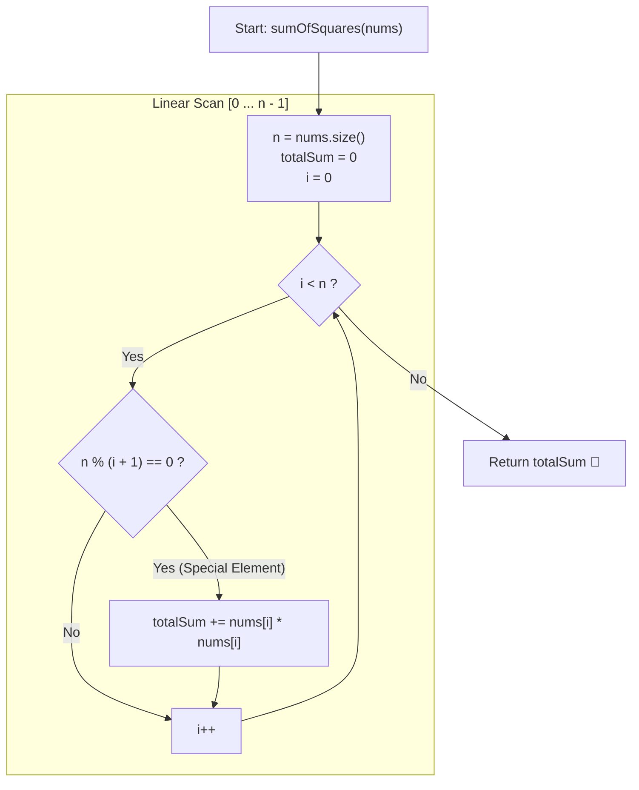

# 💡 Approach — Sum of Squares of Special Elements

  | 📄 [Problem](./Problem.md) | 💡 [Approach](./Approach.md) | 🧩 [Solution](./Solution.cpp) | 🚀 [Main](./Main.cpp) |
  |:--------------------------:|:-----------------------------:|:------------------------------:|:---------------------:|

## 📊 Metadata

---

> [!TIP]
> **Core Intuition — Divisibility Invariant & Sum of Squares:**
> 1. **Index-Length Divisibility**:
>    Given a 1-indexed array of length $n$, element $nums[i]$ at position $1 \le i \le n$ is defined as *special* if $n \pmod i == 0$.
> 2. **0-Indexed Translation**:
>    In C++, the element at 0-based index $j$ corresponds to 1-based index $i = j + 1$. Thus, the divisibility criterion is expressed as $n \pmod{j + 1} == 0$.
> 3. **Divisor Factorization vs. Linear Pass**:
>    - Because $n \le 50$, a simple linear scan over all $n$ indices takes at most $50$ iterations ($\mathcal{O}(n)$).
>    - Alternatively, one could enumerate only divisors of $n$ up to $\sqrt{n}$ ($\mathcal{O}(\sqrt{n})$), pairing divisor $d$ with complement $n / d$.

---

## 🔩 Step-by-Step Breakdown

### Method 1: Linear Scan & Enumeration ($\mathcal{O}(n)$ Time, $\mathcal{O}(1)$ Space) — Primary

1. **Initialization**:
   - Let $n = nums.\text{size}()$.
   - Initialize integer accumulator `totalSum = 0`.
2. **Scan All Elements**:
   - For each 0-based index $i$ from $0$ to $n - 1$:
     - Check if $n \pmod{i + 1} == 0$.
     - If true, add $nums[i] \times nums[i]$ to `totalSum`.
3. **Return Result**:
   - Return `totalSum`.

---

### Method 2: Divisor Pair Enumeration ($\mathcal{O}(\sqrt{n})$ Time, $\mathcal{O}(1)$ Space) — Alternative

1. **Initialization**:
   - Let $n = nums.\text{size}()$.
   - Initialize integer accumulator `totalSum = 0`.
2. **Iterate Up to $\sqrt{n}$**:
   - For each integer $d \ge 1$ where $d \times d \le n$:
     - If $n \pmod d == 0$:
       - Add square of element at 1-based index $d$: $nums[d - 1]^2$.
       - Compute complement divisor $c = n / d$.
       - If $c \ne d$, also add square of element at 1-based index $c$: $nums[c - 1]^2$.
3. **Return Result**:
   - Return `totalSum`.

---

## 🔄 Mermaid Flowchart

---

## 🏃‍♂️ Dry Run

### Detailed Walkthrough: Example 1 ($nums = [1, 2, 3, 4], n = 4$)

- **Input**: $nums = [1, 2, 3, 4]$, $n = 4$.
- **Accumulator**: `totalSum = 0`.

| Index $i$ (0-based) | 1-based Index $i + 1$ | $nums[i]$ | Condition $4 \pmod{i + 1} == 0$ | Special? | Contribution | Running `totalSum` |
|:---:|:---:|:---:|:---:|:---:|:---:|:---:|
| 0 | 1 | 1 | $4 \pmod 1 == 0$ | **Yes** | $1^2 = 1$ | $0 + 1 = 1$ |
| 1 | 2 | 2 | $4 \pmod 2 == 0$ | **Yes** | $2^2 = 4$ | $1 + 4 = 5$ |
| 2 | 3 | 3 | $4 \pmod 3 == 1$ | **No** | $0$ | $5$ |
| 3 | 4 | 4 | $4 \pmod 4 == 0$ | **Yes** | $4^2 = 16$ | $5 + 16 = 21$ |

- **Final Result**: $21$.

---

### Detailed Walkthrough: Example 2 ($nums = [2, 7, 1, 19, 18, 3], n = 6$)

- **Input**: $nums = [2, 7, 1, 19, 18, 3]$, $n = 6$.
- **Divisors of 6**: $1, 2, 3, 6$.

| 1-based Index | Element | Square | Included? |
|:---:|:---:|:---:|:---:|
| 1 | $nums[0] = 2$ | $4$ | Yes |
| 2 | $nums[1] = 7$ | $49$ | Yes |
| 3 | $nums[2] = 1$ | $1$ | Yes |
| 4 | $nums[3] = 19$ | — | No ($6 \nmid 4$) |
| 5 | $nums[4] = 18$ | — | No ($6 \nmid 5$) |
| 6 | $nums[5] = 3$ | $9$ | Yes |

- **Sum**: $4 + 49 + 1 + 9 = 63$.

---

## 📊 Complexity Analysis

| Complexity Metric | Estimation | Rationale |
| :--- | :---: | :--- |
| **Time Complexity (Method 1)** | $\mathcal{O}(n)$ | Iterating from index $0$ to $n - 1$ performs $n$ constant-time modulo checks and arithmetic multiplications. |
| **Time Complexity (Method 2)** | $\mathcal{O}(\sqrt{n})$ | Enumerating divisors from $1$ up to $\lfloor\sqrt{n}\rfloor$ requires at most $\sqrt{50} \approx 7$ operations. |
| **Auxiliary Space** | $\mathcal{O}(1)$ | Only a few integer variables (`totalSum`, `i`, `n`) are allocated during execution. |

---

> *"The special nature of an element is not derived from its magnitude, but from the rhythm with which its position harmonizes with the whole."*

---

<h3>Happy Coding! 🚀</h3>

