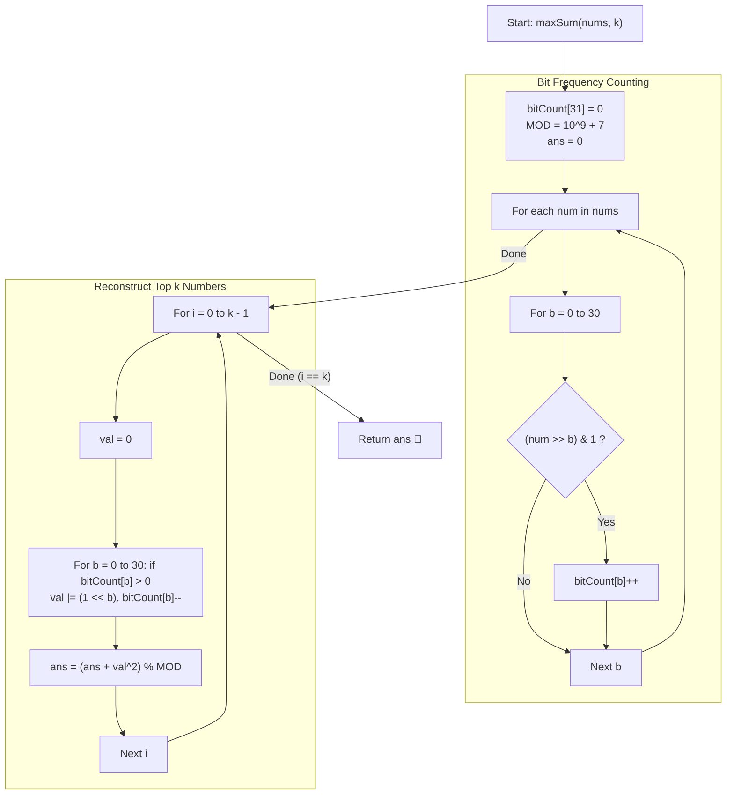

# 💡 Approach — Apply Operations on Array to Maximize Sum of Squares

  | 📄 [Problem](./Problem.md) | 💡 [Approach](./Approach.md) | 🧩 [Solution](./Solution.cpp) | 🚀 [Main](./Main.cpp) |
  |:--------------------------:|:-----------------------------:|:------------------------------:|:---------------------:|

## 📊 Metadata

---

> [!TIP]
> **Core Intuition — Bit Conservation & Majorization Principle:**
> 1. **Bit Invariant**:
>    Given two values $x$ and $y$, their replacements $x' = x \text{ AND } y$ and $y' = x \text{ OR } y$ maintain:
>    - $x' + y' = x + y$ (conservation of linear sum)
>    - For each bit position $b$, the total number of $1$-bits across the array remains exactly identical.
> 2. **Convexity of $f(t) = t^2$**:
>    Because $(x' + y')^2 - 2x'y' = (x + y)^2 - 2x'y'$, and $x'y' = (x \text{ AND } y)(x \text{ OR } y) \le xy$, it follows that:
>    $$(x \text{ AND } y)^2 + (x \text{ OR } y)^2 \ge x^2 + y^2$$
>    Any operation strictly increases (or preserves) the sum of squares. By Hardy-Littlewood-Pólya majorization, maximizing the sum of squares requires concentrating the values to make the largest elements as large as possible.
> 3. **Independent Bit Sorting**:
>    Because we can pair any two elements repeatedly, bits at each position can migrate independently toward designated target elements. To build the largest $k$ numbers, the $i$-th element ($0 \le i < k$) receives a set bit at position $b$ if and only if $\text{count}[b] > i$.

---

## 🔩 Step-by-Step Breakdown

### Method 1: Bit Counting & Greedy Top-K Synthesis ($\mathcal{O}(30n)$ Time, $\mathcal{O}(1)$ Space) — Primary

1. **Count Bit Frequencies**:
   - Maintain an array `bitCount[31] = {0}`.
   - For each element $num \in nums$:
     - For each bit $b$ from $0$ to $30$:
       - If $(num \gg b) \ \& \ 1$, increment `bitCount[b]++`.
2. **Reconstruct Top $k$ Numbers**:
   - Initialize total answer `ans = 0`, with modulo $MOD = 10^9 + 7$.
   - Iterate $i$ from $0$ to $k - 1$ (generating each of the top $k$ numbers):
     - Initialize `val = 0`.
     - For each bit $b$ from $0$ to $30$:
       - If `bitCount[b] > 0`:
         - Set the $b$-th bit: `val |= (1LL << b)`.
         - Decrement `bitCount[b]--`.
     - Accumulate square modulo $MOD$:
       $$\text{ans} = (\text{ans} + (\text{val} \pmod{MOD}) \times (\text{val} \pmod{MOD})) \pmod{MOD}$$
3. **Return Result**:
   - Return `ans`.

---

### Method 2: Direct Threshold Comparison ($\mathcal{O}(30n)$ Time, $\mathcal{O}(1)$ Space) — Alternative

1. **Count Bit Frequencies**:
   - Record `bitCount[b]` for all $0 \le b \le 30$.
2. **Construct $i$-th Number by Threshold**:
   - For index $i \in [0, k - 1]$:
     - `val = 0`.
     - For each bit $b \in [0, 30]$:
       - If `bitCount[b] > i`, set $b$-th bit: `val |= (1LL << b)`.
     - Add $(\text{val} \times \text{val}) \pmod{MOD}$ to `ans`.
3. **Return Result**:
   - Both methods produce identical answers; Method 2 avoids modifying the count buffer.

---

## 🔄 Mermaid Flowchart

---

## 🏃‍♂️ Dry Run

### Detailed Walkthrough: Example 1 ($nums = [2, 6, 5, 8], k = 2$)

- **Binary Representations**:
  - $2 = 0010_2$
  - $6 = 0110_2$
  - $5 = 0101_2$
  - $8 = 1000_2$
- **Bit Frequency Table**:
  - Bit 0: $\{5\} \implies \text{count} = 1$
  - Bit 1: $\{2, 6\} \implies \text{count} = 2$
  - Bit 2: $\{6, 5\} \implies \text{count} = 2$
  - Bit 3: $\{8\} \implies \text{count} = 1$
  - All other bits: $0$.

| Target Element $i$ | Available Bits Included | Value Formed (Binary) | Value (Decimal) | Square | Running Sum $\pmod{10^9+7}$ |
|:---:|:---:|:---:|:---:|:---:|:---:|
| 1st ($i = 0$) | Bits 0, 1, 2, 3 (all count $\ge 1$) | $1111_2$ | 15 | $15^2 = 225$ | 225 |
| 2nd ($i = 1$) | Bits 1, 2 (count $\ge 2$) | $0110_2$ | 6 | $6^2 = 36$ | $225 + 36 = 261$ |

- **Final Answer**: $261$.

---

### Detailed Walkthrough: Example 2 ($nums = [4, 5, 4, 7], k = 3$)

- **Binary Representations**:
  - $4 = 100_2$, $5 = 101_2$, $4 = 100_2$, $7 = 111_2$.
- **Bit Counts**:
  - Bit 0: $\{5, 7\} \implies 2$
  - Bit 1: $\{7\} \implies 1$
  - Bit 2: $\{4, 5, 4, 7\} \implies 4$

| Target Element $i$ | Bits Included | Value Formed | Square | Running Sum |
|:---:|:---:|:---:|:---:|:---:|
| 1st ($i = 0$) | Bits 0, 1, 2 | $111_2 = 7$ | 49 | 49 |
| 2nd ($i = 1$) | Bits 0, 2 | $101_2 = 5$ | 25 | $49 + 25 = 74$ |
| 3rd ($i = 2$) | Bit 2 | $100_2 = 4$ | 16 | $74 + 16 = 90$ |

- **Final Answer**: $90$.

---

## 📊 Complexity Analysis

| Complexity Metric | Estimation | Rationale |
| :--- | :---: | :--- |
| **Time Complexity** | $\mathcal{O}(n \log(\max(nums)))$ | Counting set bits takes $31 \times n$ iterations. Reconstructing $k$ numbers takes $31 \times k$ iterations. Since $nums[i] \le 10^9 < 2^{30}$, $30 \times (n + k) \le 6 \times 10^6$ operations, which executes in $< 10$ ms. |
| **Auxiliary Space** | $\mathcal{O}(\log(\max(nums))) \approx \mathcal{O}(1)$ | Only a fixed-size frequency array of length $31$ is required to store bit counts. |

---

> *"The symmetry of bits under logical transfer obeys the laws of dispersion and concentration — the sum of squares peaks when power is concentrated into the few."*

---

<h3>Happy Coding! 🚀</h3>

