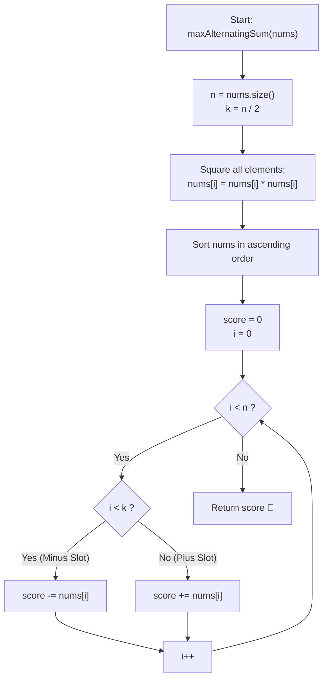

# 💡 Approach — Maximum Alternating Sum of Squares

  | 📄 [Problem](./Problem.md) | 💡 [Approach](./Approach.md) | 🧩 [Solution](./Solution.cpp) | 🚀 [Main](./Main.cpp) |
  |:--------------------------:|:-----------------------------:|:------------------------------:|:---------------------:|

## 📊 Metadata

---

> [!TIP]
> **Core Intuition — Squaring Invariance & Greedy Alternating Partition:**
> 1. **Index Parity Distribution**:
>    Given an array of length $n$, the alternating sum has $\lceil n / 2 \rceil = n - \lfloor n / 2 \rfloor$ addition slots (at even indices $0, 2, 4, \dots$) and $\lfloor n / 2 \rfloor$ subtraction slots (at odd indices $1, 3, 5, \dots$).
> 2. **Sign Invariance through Squaring**:
>    Because $(nums[i])^2 = |nums[i]|^2 \ge 0$, the signs of original values do not restrict square sizes. Every term in the sum is the square of some element chosen from $nums$.
> 3. **Greedy Maximization via Polar Partition**:
>    To maximize $\sum \text{positive terms} - \sum \text{negative terms}$, we must make the positive terms as large as possible and the negative terms as small as possible. The optimal partition assigns the $\lfloor n / 2 \rfloor$ smallest squares to the subtraction slots and the remaining $\lceil n / 2 \rceil$ largest squares to the addition slots.

---

## 🔩 Step-by-Step Breakdown

### Method 1: In-Place Squaring & Sorting ($\mathcal{O}(n \log n)$ Time, $\mathcal{O}(1)$ Auxiliary Space) — Primary

1. **Transform Elements to Squares**:
   - For each element in $nums$, square the value. Since $-4 \times 10^4 \le nums[i] \le 4 \times 10^4$, $(nums[i])^2 \le 1.6 \times 10^9$, which fits inside a standard 32-bit signed integer or a 64-bit integer buffer.
2. **Sort in Ascending Order**:
   - Sort the array of squares in non-decreasing order: $nums[0] \le nums[1] \le \dots \le nums[n-1]$.
3. **Partition Across Midpoint $\lfloor n / 2 \rfloor$**:
   - Let $k = \lfloor n / 2 \rfloor$.
   - The first $k$ elements $nums[0 \dots k-1]$ represent the smallest $k$ squares and are subtracted from the score.
   - The remaining $n - k$ elements $nums[k \dots n-1]$ represent the largest squares and are added to the score.
4. **Accumulate & Return 64-bit Score**:
   - Initialize `score = 0LL`.
   - Subtract $\sum_{i=0}^{k-1} nums[i]$ and add $\sum_{i=k}^{n-1} nums[i]$.
   - Return `score`.

---

### Method 2: Quickselect / Median-of-Parity Linear Partition ($\mathcal{O}(n)$ Time, $\mathcal{O}(1)$ Auxiliary Space) — Alternative

1. **Calculate Subtraction Count**:
   - Set $k = \lfloor n / 2 \rfloor$.
2. **Apply Quickselect via `std::nth_element`**:
   - Rearrange $nums$ such that the $k$ elements with the smallest absolute values (or squared values) are partitioned into the range $[0, k-1]$ without fully sorting the two halves.
   - Using comparator $\lambda(a, b): 1\text{LL} \times a \times a < 1\text{LL} \times b \times b$.
3. **Linear Accumulation**:
   - Iterate through index $0$ to $k-1$: subtract $1\text{LL} \times nums[i] \times nums[i]$ from `score`.
   - Iterate through index $k$ to $n-1$: add $1\text{LL} \times nums[i] \times nums[i]$ to `score`.
4. **Return Linear Sum**:
   - Achieves $\mathcal{O}(n)$ expected time complexity without requiring a full $\mathcal{O}(n \log n)$ sort.

---

## 🔄 Mermaid Flowchart

---

## 🏃‍♂️ Dry Run

### Example 1: `nums = [1, 2, 3]`, $n = 3, k = \lfloor 3 / 2 \rfloor = 1$

| Step | Operation / Element | Array State | Score Accumulation | Running Score |
| :---: | :--- | :--- | :--- | :---: |
| **0** | Initial array | `[1, 2, 3]` | — | $0$ |
| **1** | Square elements | `[1, 4, 9]` | — | $0$ |
| **2** | Sort ascending | `[1, 4, 9]` | $k = 1$ (1 minus slot, 2 plus slots) | $0$ |
| **3** | $i = 0 < k$: Minus slot | `nums[0] = 1` | `score -= 1` | $-1$ |
| **4** | $i = 1 \ge k$: Plus slot | `nums[1] = 4` | `score += 4` | $+3$ |
| **5** | $i = 2 \ge k$: Plus slot | `nums[2] = 9` | `score += 9` | $+12$ |

**Final Output**: $12$

---

### Example 2: `nums = [1, -1, 2, -2, 3, -3]`, $n = 6, k = \lfloor 6 / 2 \rfloor = 3$

| Step | Operation / Element | Array State | Score Accumulation | Running Score |
| :---: | :--- | :--- | :--- | :---: |
| **0** | Initial array | `[1, -1, 2, -2, 3, -3]` | — | $0$ |
| **1** | Square elements | `[1, 1, 4, 4, 9, 9]` | — | $0$ |
| **2** | Sort ascending | `[1, 1, 4, 4, 9, 9]` | $k = 3$ (3 minus slots, 3 plus slots) | $0$ |
| **3** | $i = 0, 1, 2 < 3$ | Smallest: $1, 1, 4$ | `score -= (1 + 1 + 4) = -6` | $-6$ |
| **4** | $i = 3, 4, 5 \ge 3$ | Largest: $4, 9, 9$ | `score += (4 + 9 + 9) = +22` | $+16$ |

**Final Output**: $16$

---

## 📊 Complexity Analysis

| Complexity Metric | Estimation | Rationale |
| :--- | :---: | :--- |
| **Primary Time (Sorting)** | $\mathcal{O}(n \log n)$ | Squaring takes $\mathcal{O}(n)$ time; standard in-place introsort takes $\mathcal{O}(n \log n)$ time. |
| **Alternative Time (Quickselect)** | $\mathcal{O}(n)$ | `std::nth_element` partitions the array around the $k$-th position in linear expected time. |
| **Auxiliary Space** | $\mathcal{O}(1)$ | The transformation and sorting/partitioning are performed directly in-place on the input array. |

---

> *"When alternating signs govern the sum, polarization is the optimal strategy: assign the greatest forces to the positive stride and minimize resistance on the negative retreat."*

---

<h3>Happy Coding! 🚀</h3>

