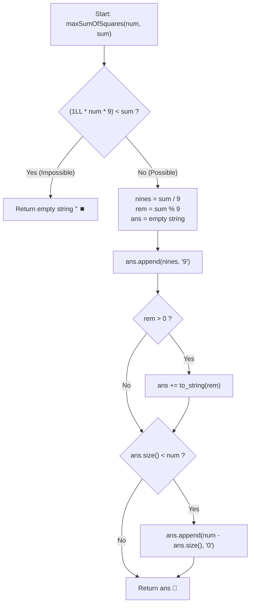

# 💡 Approach — Maximize Sum of Squares of Digits

  | 📄 [Problem](./Problem.md) | 💡 [Approach](./Approach.md) | 🧩 [Solution](./Solution.cpp) | 🚀 [Main](./Main.cpp) |
  |:--------------------------:|:-----------------------------:|:------------------------------:|:---------------------:|

## 📊 Metadata

---

> [!TIP]
> **Core Intuition — Convexity of Squares & Greedy Place-Value Assignment:**
> 1. **Majorization via Convexity**:
>    Because $f(x) = x^2$ is strictly convex on $\mathbb{R}_{\ge 0}$, any transfer of mass from smaller digits toward larger digits strictly increases the total sum of squares. For example, $9^2 + 0^2 = 81$ while $5^2 + 4^2 = 41$. Therefore, we must greedily form as many maximal digits ($9$'s) as possible.
> 2. **Numerical Value Maximization**:
>    Any permutation of a fixed multiset of digits yields the exact same sum of squares. To maximize the integer numerically, larger digits must occupy higher place values (from left to right). Thus, all $9$'s must be placed first, followed by the remainder digit, followed by all $0$'s.
> 3. **Feasibility Threshold**:
>    A number of length `num` can have a maximum digit sum of $9 \times num$. If $sum > 9 \times num$, no valid integer can be formed, so return `""`. Since $sum \ge 1$, the first digit will always be at least $1$ (either $9$ or the remainder), ensuring no positive integer starts with a leading zero.

---

## 🔩 Step-by-Step Breakdown

### Method 1: Mathematical Greedy with Direct String Allocation ($\mathcal{O}(num)$ Time, $\mathcal{O}(num)$ Space) — Primary

1. **Feasibility Check**:
   - Check if $1\text{LL} \times num \times 9 < sum$. If true, return `""` immediately.
2. **Compute Digit Counts**:
   - Calculate the number of full $9$'s: `nines = sum / 9`.
   - Calculate the remainder digit: `rem = sum % 9`.
3. **Assemble Result String**:
   - Pre-allocate a string of capacity `num`: `ans.reserve(num)`.
   - Append `nines` occurrences of character `'9'`.
   - If `rem > 0`, append the character `'0' + rem`.
   - If `ans.size() < num`, pad the remaining positions with `'0'`: `ans.append(num - ans.size(), '0')`.
4. **Return Result**:
   - Return `ans`.

---

### Method 2: Position-by-Position Feasibility Simulation ($\mathcal{O}(num)$ Time, $\mathcal{O}(num)$ Space) — Alternative

1. **Validation**:
   - If $1\text{LL} \times num \times 9 < sum$, return `""`.
2. **Iterative Greedy Fill**:
   - For each position $i$ from $0$ to $num - 1$:
     - Remaining positions after $i$: `remPos = num - 1 - i`.
     - Find the largest digit $d \in [0, 9]$ such that $sum - d \le remPos \times 9$ and $d \le sum$:
       - To maximize sum of squares and place-value, we greedily take $d = \min(9, sum)$.
     - Append digit $d$ to the string and decrement `sum -= d`.
3. **Return String**:
   - Returns the identical optimal canonical string.

---

## 🔄 Mermaid Flowchart

---

## 🏃‍♂️ Dry Run

### Example 1: `num = 2, sum = 3`

| Step | Operation / Parameter | Value / State | Explanation |
| :---: | :--- | :--- | :--- |
| **1** | Feasibility Check | $2 \times 9 = 18 \ge 3$ | Valid configuration exists |
| **2** | Compute $9$'s and Remainder | `nines = 3 / 9 = 0`, `rem = 3 % 9 = 3` | Zero $9$'s, remainder is $3$ |
| **3** | Append $9$'s | `""` | No $9$'s added |
| **4** | Append Remainder | `"3"` | Digit $3$ placed at leading position |
| **5** | Pad with Zeros | `"30"` | Padded to length $2$ with one `'0'` |

**Final Output**: `"30"`

---

### Example 2: `num = 2, sum = 17`

| Step | Operation / Parameter | Value / State | Explanation |
| :---: | :--- | :--- | :--- |
| **1** | Feasibility Check | $2 \times 9 = 18 \ge 17$ | Valid configuration exists |
| **2** | Compute $9$'s and Remainder | `nines = 17 / 9 = 1`, `rem = 17 % 9 = 8` | One $9$, remainder is $8$ |
| **3** | Append $9$'s | `"9"` | One $9$ placed at highest place value |
| **4** | Append Remainder | `"98"` | Remainder $8$ appended |
| **5** | Pad with Zeros | `"98"` | Already length $2$, no padding needed |

**Final Output**: `"98"`

---

## 📊 Complexity Analysis

| Complexity Metric | Estimation | Rationale |
| :--- | :---: | :--- |
| **Time Complexity** | $\mathcal{O}(num)$ | Computing counts takes $\mathcal{O}(1)$ math; string concatenation of length $num$ takes $\mathcal{O}(num)$ time. |
| **Auxiliary Space** | $\mathcal{O}(num)$ | Required to store and return the generated digit string of length $num$. |

---

> *"Convexity demands concentration: to maximize the sum of squares under a linear budget, load the highest allowable units onto the most prominent positions."*

---

<h3>Happy Coding! 🚀</h3>

