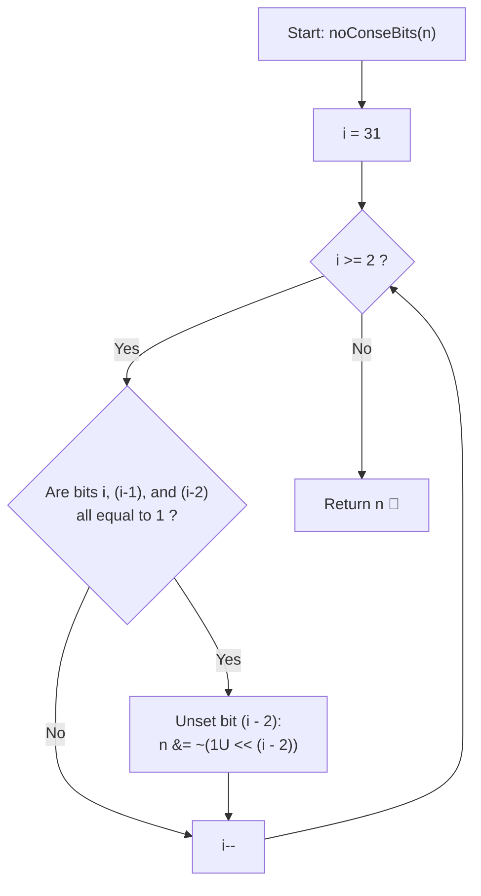

# 💡 Approach — Geek hates too many 1s

  | 📄 [Problem](./Problem.md) | 💡 [Approach](./Approach.md) | 🧩 [Solution](./Solution.cpp) | 🚀 [Main](./Main.cpp) |
  |:--------------------------:|:-----------------------------:|:------------------------------:|:---------------------:|

## 📊 Metadata

---

> [!TIP]
> **Core Intuition — Positional Value Disparity & Greedy Triplet Clearing:**
> 1. **Exponential Power of Significance**:
>    Each bit position $k$ contributes $2^k$ to the total value. Crucially, $2^k > \sum_{j=0}^{k-1} 2^j = 2^k - 1$. This means preserving a single higher bit is always strictly more valuable than preserving *all* lower bits combined.
> 2. **Optimal Triplet Elimination**:
>    If three consecutive bits $(i, i-1, i-2)$ are all set to $1$, we are forced to turn at least one bit to $0$ to prevent the substring `111`. To maximize the remaining number, we must deduct the smallest possible value:
>    $$\min(2^i, 2^{i-1}, 2^{i-2}) = 2^{i-2}$$
>    Hence, we always unset the least significant bit of the triplet ($i-2$).
> 3. **Run Termination & Cascade Prevention**:
>    Once bit $i-2$ is turned to $0$, it acts as a barrier: bit $i-3$ cannot form a triplet with $i-2$ and $i-1$, effectively resetting the consecutive counter to $0$.

---

## 🔩 Step-by-Step Breakdown

### Method 1: Greedy In-Place Bit Triplet Clearing ($\mathcal{O}(1)$ Time, $\mathcal{O}(1)$ Space) — Primary

1. **Traverse Bits from MSB to LSB**:
   - Loop index $i$ downwards from $31$ down to $2$.
2. **Inspect Triplet Window**:
   - Check if bit $i$, bit $i-1$, and bit $i-2$ are all currently set ($1$):
     $$\text{triplet\_set} = (n \ \& \ (1\text{U} \ll i)) \neq 0 \ \land \ (n \ \& \ (1\text{U} \ll (i - 1))) \neq 0 \ \land \ (n \ \& \ (1\text{U} \ll (i - 2))) \neq 0$$
3. **Clear the Lowest Bit in the Triplet**:
   - If the triplet is set, unset bit $i-2$ using a bitwise AND with inverted mask:
     $$n = n \ \& \ \sim(1\text{U} \ll (i - 2))$$
4. **Return Final Value**:
   - After the loop reaches $i = 2$, return $n$.

---

### Method 2: Consecutive 1s Counter / State Machine ($\mathcal{O}(1)$ Time, $\mathcal{O}(1)$ Space) — Alternative

1. **Initialize Counter**:
   - Set `consecutiveOnes = 0`.
2. **Sweep Single Bit at a Time**:
   - For $i$ from $31$ down to $0$:
     - If bit $i$ is set:
       - Increment `consecutiveOnes++`.
       - If `consecutiveOnes == 3`:
         - Unset bit $i$: $n = n \ \& \ \sim(1\text{U} \ll i)$.
         - Reset `consecutiveOnes = 0`.
     - Else (bit $i$ is $0$):
       - Reset `consecutiveOnes = 0`.
3. **Return Clean Value**:
   - Yields an identical optimal result while using a simple running counter.

---

### Method 3: Bit Array Extraction & Reconstruction ($\mathcal{O}(1)$ Time, $\mathcal{O}(1)$ Space) — Explicit

1. **Extract to Binary Array**:
   - Store all $32$ bits of $n$ into an array `bits[32]`, where `bits[i]` holds the bit at position $i$.
2. **Scan and Resolve**:
   - Traverse from $i = 31$ down to $2$:
     - If `bits[i] == 1 && bits[i-1] == 1 && bits[i-2] == 1`:
       - Set `bits[i-2] = 0`.
3. **Reconstruct Integer**:
   - Accumulate $\sum_{i=0}^{31} \text{bits}[i] \times 2^i$ into the final result.

---

## 🔄 Mermaid Flowchart

---

## 🏃‍♂️ Dry Run

### Example 1: `n = 7` (Binary: `...000111`)

| Step $i$ | Binary Window `[i, i-1, i-2]` | Bits Values | Action Taken | Resulting $n$ (Binary) |
| :---: | :---: | :---: | :--- | :--- |
| **$i \ge 3$** | Bits above 2 | All zeros | None | `000111` ($7$) |
| **$i = 2$** | Bits `[2, 1, 0]` | `1, 1, 1` | Unset bit $0$: `n &= ~(1U << 0)` | `000110` ($6$) |

**Final Output**: $6$

---

### Example 2: `n = 15` (Binary: `...001111`)

| Step $i$ | Binary Window `[i, i-1, i-2]` | Bits Values | Action Taken | Resulting $n$ (Binary) |
| :---: | :---: | :---: | :--- | :--- |
| **$i = 3$** | Bits `[3, 2, 1]` | `1, 1, 1` | Unset bit $1$: `n &= ~(1U << 1)` | `001101` ($13$) |
| **$i = 2$** | Bits `[2, 1, 0]` | `1, 0, 1` | No violation (bit 1 is $0$) | `001101` ($13$) |

**Final Output**: $13$

---

### Example 3: `n = 31` (Binary: `...011111`)

| Step $i$ | Binary Window `[i, i-1, i-2]` | Bits Values | Action Taken | Resulting $n$ (Binary) |
| :---: | :---: | :---: | :--- | :--- |
| **$i = 4$** | Bits `[4, 3, 2]` | `1, 1, 1` | Unset bit $2$: `n &= ~(1U << 2)` | `011011` ($27$) |
| **$i = 3$** | Bits `[3, 2, 1]` | `1, 0, 1` | No violation | `011011` ($27$) |
| **$i = 2$** | Bits `[2, 1, 0]` | `0, 1, 1` | No violation | `011011` ($27$) |

**Final Output**: $27$

---

## 📊 Complexity Analysis

| Complexity Metric | Estimation | Rationale |
| :--- | :---: | :--- |
| **Time Complexity** | $\mathcal{O}(1)$ | The loop executes exactly $30$ times (from $i = 31$ down to $2$), performing constant-time bitwise operations in each iteration. |
| **Auxiliary Space** | $\mathcal{O}(1)$ | Bit modifications are carried out directly in-place without auxiliary heap or dynamic data structures. |

---

> *"In binary arithmetic, place value reigns supreme: when forced to break a run of ones, sacrifice the least significant bit to preserve the maximum numerical weight."*

---

<h3>Happy Coding! 🚀</h3>

