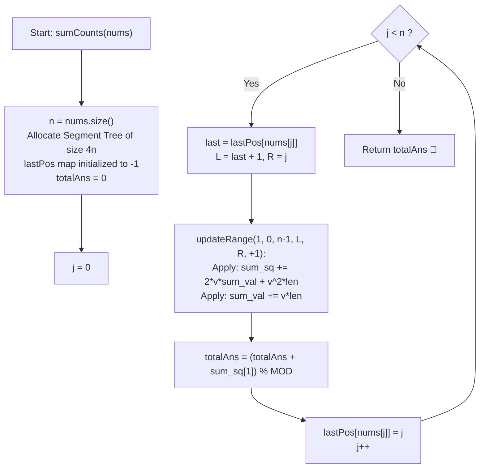

# 💡 Approach — Subarrays Distinct Element Sum of Squares II

  | 📄 [Problem](./Problem.md) | 💡 [Approach](./Approach.md) | 🧩 [Solution](./Solution.cpp) | 🚀 [Main](./Main.cpp) |
  |:--------------------------:|:-----------------------------:|:------------------------------:|:---------------------:|

## 📊 Metadata

---

> [!TIP]
> **Core Intuition — Dynamic Segment Tree with Algebraic Range Squares:**
> 1. **Right Endpoint Sweeping**:
>    Let $d_i$ represent the count of distinct elements in subarray $nums[i..j]$ for a fixed right boundary $j$.
>    When moving from $j - 1$ to $j$:
>    - If $nums[j]$ previously appeared at index $last$ (or $-1$ if first occurrence), then $nums[j]$ is a *new* distinct element for every starting index $i$ in $[last + 1, j]$.
>    - For all $i \le last$, $nums[j]$ is already present in $nums[i..j-1]$, so $d_i$ remains unchanged.
>    - Hence, every $d_i$ for $i \in [last + 1, j]$ receives an increment of $+1$.
> 2. **Algebraic Expansion of Sum of Squares**:
>    When a constant $v$ is added to each $d_i$ across a range of length $len$:
>    $$(d_i + v)^2 = d_i^2 + 2v \cdot d_i + v^2$$
>    Summing across all indices in the node's interval:
>    $$\sum (d_i + v)^2 = \sum d_i^2 + 2v \sum d_i + v^2 \cdot len$$
>    $$\sum (d_i + v) = \sum d_i + v \cdot len$$
> 3. **Instant Prefix Aggregation**:
>    At each step $j$, the sum of squares of distinct counts for all subarrays ending at $j$ is simply $\sum_{i=0}^j d_i^2$. Because all $d_i$ for $i > j$ are $0$, querying the total tree root $\sum_{i=0}^{n-1} d_i^2$ provides the exact contribution in $\mathcal{O}(1)$ time after an $\mathcal{O}(\log n)$ range update!

---

## 🔩 Step-by-Step Breakdown

### Method 1: Array-Based Segment Tree with Lazy Propagation ($\mathcal{O}(n \log n)$ Time, $\mathcal{O}(n)$ Space) — Primary

1. **Segment Tree Structure**:
   - Allocate arrays `sum_sq`, `sum_val`, and `lazy` of size $4n$.
   - Each node $u$ covers interval $[l, r]$:
     - `sum_sq[u]`: $\sum_{i=l}^r d_i^2 \pmod{MOD}$
     - `sum_val[u]`: $\sum_{i=l}^r d_i \pmod{MOD}$
     - `lazy[u]`: Pending addition tag to be pushed to children.
2. **Node Application & Lazy Tag Propagation**:
   - To apply tag $v$ to node $u$ covering $[l, r]$:
     $$\text{len} = r - l + 1$$
     $$\text{sum\_sq}[u] = (\text{sum\_sq}[u] + 2v \cdot \text{sum\_val}[u] + v^2 \cdot \text{len}) \pmod{MOD}$$
     $$\text{sum\_val}[u] = (\text{sum\_val}[u] + v \cdot \text{len}) \pmod{MOD}$$
     $$\text{lazy}[u] = (\text{lazy}[u] + v) \pmod{MOD}$$
   - When visiting children, push down `lazy[u]` to $2u$ and $2u + 1$, then reset `lazy[u] = 0`.
3. **Sweeping Right Boundary $j$**:
   - Maintain `lastPos` lookup table (or hash map) initialized to $-1$.
   - For $j = 0 \dots n - 1$:
     - Retrieve $last = \text{lastPos}[nums[j]]$.
     - Range update: add $+1$ to interval $[last + 1, j]$.
     - Accumulate root's sum of squares:
       $$\text{totalAns} = (\text{totalAns} + \text{sum\_sq}[1]) \pmod{MOD}$$
     - Update $\text{lastPos}[nums[j]] = j$.
4. **Final Return**:
   - Return `totalAns`.

---

### Method 2: Dual Binary Indexed Trees (Fenwick Trees) ($\mathcal{O}(n \log n)$ Time, $\mathcal{O}(n)$ Space) — Mathematical Alternative

1. **Difference Array Representation**:
   - Instead of maintaining squares directly in BIT, we can maintain the linear terms and coefficients using dual BITs to achieve range add and range sum queries.
   - However, since squaring requires tracking quadratic interactions, maintaining explicit linear and quadratic statistics via a Segment Tree offers the most direct and reliable $\mathcal{O}(n \log n)$ approach.

---

### Method 3: Brute-Force Quadratic Enumeration ($\mathcal{O}(n^2)$ Time, $\mathcal{O}(n)$ Space) — Verification Reference

1. **Subarray Simulation**:
   - For small $n \le 1000$, iterate all starting points $i \in [0, n - 1]$.
   - Expand $j$ from $i$ to $n - 1$ while tracking distinct count using a frequency table.
   - Add $distinct^2$ to the accumulator. Used for testing edge cases and verifying algorithmic equivalence.

---

## 🔄 Mermaid Flowchart

---

## 🏃‍♂️ Dry Run

### Example 1: `nums = [1, 2, 1]` ($n = 3, MOD = 10^9 + 7$)

Initially, all $d_i = 0$ for $i \in [0, 2]$. Total answer $= 0$.

| Step $j$ | $nums[j]$ | $last$ | Interval $[L, R]$ | Updated $d$ Array | Active Subarrays Ending at $j$ | Root `sum_sq[1]` | Running `totalAns` |
| :---: | :---: | :---: | :---: | :---: | :---: | :---: | :---: |
| **0** | $1$ | $-1$ | $[0, 0]$ | $d = [1, 0, 0]$ | $nums[0..0]: [1] \implies 1^2 = 1$ | $1$ | $1$ |
| **1** | $2$ | $-1$ | $[0, 1]$ | $d = [2, 1, 0]$ | $nums[0..1]: [1, 2] \implies 2^2 = 4$ $nums[1..1]: [2] \implies 1^2 = 1$ | $4 + 1 = 5$ | $1 + 5 = 6$ |
| **2** | $1$ | $0$ | $[1, 2]$ | $d = [2, 2, 1]$ | $nums[0..2]: [1, 2, 1] \implies 2^2 = 4$ $nums[1..2]: [2, 1] \implies 2^2 = 4$ $nums[2..2]: [1] \implies 1^2 = 1$ | $4 + 4 + 1 = 9$ | $6 + 9 = 15$ |

**Final Result**: `15`.

---

### Example 2: `nums = [2, 2]` ($n = 2$)

| Step $j$ | $nums[j]$ | $last$ | Interval | Updated $d$ | Subarrays Ending at $j$ | Root `sum_sq[1]` | `totalAns` |
| :---: | :---: | :---: | :---: | :---: | :---: | :---: | :---: |
| **0** | $2$ | $-1$ | $[0, 0]$ | $d = [1, 0]$ | $[2] \implies 1^2 = 1$ | $1$ | $1$ |
| **1** | $2$ | $0$ | $[1, 1]$ | $d = [1, 1]$ | $[2, 2] \implies 1^2 = 1$ $[2] \implies 1^2 = 1$ | $1 + 1 = 2$ | $1 + 2 = 3$ |

**Final Result**: `3`.

---

## 📊 Complexity Analysis

| Complexity Metric | Estimation | Rationale |
| :---: | :---: | :--- |
| **Time Complexity** | $\mathcal{O}(n \log n)$ | For each of the $n$ elements, we perform a single range update in the Segment Tree. A range update visits at most $\mathcal{O}(\log n)$ canonical nodes and pushes lazy tags in $\mathcal{O}(1)$ time per node. Thus, the total time across all $n$ steps is $\mathcal{O}(n \log n)$. |
| **Auxiliary Space** | $\mathcal{O}(n)$ | The Segment Tree uses arrays of size $4n$ for `sum_sq`, `sum_val`, and `lazy`. The `lastPos` lookup table consumes at most $\mathcal{O}(\max(nums[i]))$ or $\mathcal{O}(n)$ space. Overall auxiliary space is strictly linear $\mathcal{O}(n)$. |

---

> *"When simple enumeration collides with quadratic scaling, algebraic insight into how differences propagate transforms the impossible into the logarithmic."*

---

<h3>Happy Coding! 🚀</h3>

