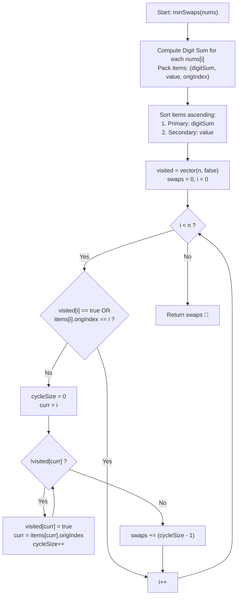

# 💡 Approach — Minimum Swaps to Sort by Digit Sum

  | 📄 [Problem](./Problem.md) | 💡 [Approach](./Approach.md) | 🧩 [Solution](./Solution.cpp) | 🚀 [Main](./Main.cpp) |
  |:--------------------------:|:-----------------------------:|:------------------------------:|:---------------------:|

## 📊 Metadata

---

> [!TIP]
> **Core Intuition — Permutation Cycle Decomposition & Custom Comparator:**
> 1. **Determining the Sorted Invariant**:
>    Every distinct number $x \in nums$ possesses two sorting keys:
>    - Primary key: Sum of decimal digits $S(x) = \sum \text{digits}(x)$.
>    - Secondary key: Numerical magnitude $x$ (tie-breaker).
>    Sorting these pairs alongside their original indices creates an unambiguous bijection from original positions to target positions.
> 2. **Cycle Graph Construction**:
>    Because elements are distinct, rearranging the array corresponds to applying a permutation $\pi$ on indices $\{0, 1, \dots, n - 1\}$. In $\pi$, an element currently at index $u$ must relocate to index $\text{target}(u)$.
> 3. **Algebraic Minimality of Swaps**:
>    Any permutation decomposes uniquely into disjoint directed cycles $C_1, C_2, \dots, C_k$.
>    Each swap between two elements within a cycle of length $L$ decomposes the cycle into two smaller disjoint cycles of lengths $L_a + L_b = L$. By induction, resolving a cycle of length $L$ into $L$ fixed-point self-loops requires exactly $L - 1$ swaps.
>    Thus, the minimum total swaps across all components is:
>    $$\text{Total Swaps} = \sum_{i=1}^{k} (L_i - 1) = \sum L_i - k = n - k$$
>    where $k$ is the total number of disjoint cycles (including cycles of length 1).

---

## 🔩 Step-by-Step Breakdown

### Method 1: Permutation Cycle Decomposition ($\mathcal{O}(n \log n)$ Time, $\mathcal{O}(n)$ Space) — Primary

1. **Calculate Digit Sums and Index Packaging**:
   - For each element $nums[i]$, calculate its digit sum:
     $$S(nums[i]) = \sum_{d \in \text{digits}(nums[i])} d$$
   - Package each element as a tuple: $(S(nums[i]), nums[i], i)$.
2. **Sort According to Criteria**:
   - Sort the tuples ascending by $(S(nums[i]), nums[i])$.
   - In the sorted array, the element at index $j$ needs to end up at index $j$, but originated from `sorted_nums[j].orig_idx`.
3. **Trace Disjoint Cycles**:
   - Allocate a boolean array `visited` of size $n$, initialized to `false`.
   - Iterate index $i$ from $0$ to $n - 1$:
     - If `visited[i] == true` or `sorted_nums[i].orig_idx == i` (element already in place), skip it.
     - Otherwise, traverse the directed path:
       $$\text{curr} \leftarrow \text{sorted\_nums}[\text{curr}].\text{orig\_idx}$$
       marking each visited node until closing the loop.
     - Increment `cycle_size` at each step.
     - If $\text{cycle\_size} > 1$, accumulate $(\text{cycle\_size} - 1)$ into `minSwaps`.
4. **Return Minimum Swaps**:
   - Return the accumulated count `minSwaps`.

---

### Method 2: Disjoint Set Union (DSU / Union-Find) ($\mathcal{O}(n \log n)$ Time, $\mathcal{O}(n)$ Space) — Component Count

1. **Component Grouping**:
   - Union the original position $i$ with the target position `sorted_nums[i].orig_idx`.
   - Count the number of connected components $k$ in the DSU.
   - The answer is algebraically equivalent to:
     $$\text{Swaps} = n - k$$
   - DSU operates with nearly $\mathcal{O}(1)$ inverse Ackermann complexity $\alpha(n)$, yielding overall $\mathcal{O}(n \log n)$ runtime dominated by initial sorting.

---

### Method 3: Direct In-Place Swapping Simulation ($\mathcal{O}(n \log n)$ Time, $\mathcal{O}(n)$ Space) — Verification Reference

1. **Target Index Array**:
   - Map each original position $i$ to its destination index in an auxiliary array `targetPos`.
   - While $i < n$:
     - If `targetPos[i] != i`, swap elements at index $i$ and `targetPos[i]`, increment swap counter, and repeat until the correct element sits at index $i$.
     - Increment $i$.
   - Directly executes the minimal swap sequence physically.

---

## 🔄 Mermaid Flowchart

---

## 🏃‍♂️ Dry Run

### Example 1: `nums = [37, 100]`

- Digit sums: $S(37) = 3 + 7 = 10$, $S(100) = 1 + 0 + 0 = 1$.
- Indexed packaging:
  - Index 0: `(10, 37, orig = 0)`
  - Index 1: `(1, 100, orig = 1)`
- Sorted order:
  - Position 0: `(1, 100, orig = 1)`
  - Position 1: `(10, 37, orig = 0)`

| Cycle Step | $i$ | `visited[i]` | Traversal Path | Cycle Nodes | Cycle Size $L$ | Added Swaps ($L - 1$) | Running Total |
| :---: | :---: | :---: | :---: | :---: | :---: | :---: | :---: |
| **1** | $0$ | `false` | $0 \to 1 \to 0$ | $\{0, 1\}$ | $2$ | $2 - 1 = 1$ | $1$ |
| **2** | $1$ | `true` | Skipped | — | — | — | $1$ |

**Final Result**: `1`.

---

### Example 3: `nums = [18, 43, 34, 16]`

- Digit sums: $S(18) = 9, S(43) = 7, S(34) = 7, S(16) = 7$.
- Sorted order by $(S(x), x)$:
  - Position 0: `16` (sum 7, value 16, orig = 3)
  - Position 1: `34` (sum 7, value 34, orig = 2)
  - Position 2: `43` (sum 7, value 43, orig = 1)
  - Position 3: `18` (sum 9, value 18, orig = 0)

| Cycle Step | $i$ | `visited[i]` | Traversal Path | Cycle Nodes | Cycle Size $L$ | Added Swaps ($L - 1$) | Running Total |
| :---: | :---: | :---: | :---: | :---: | :---: | :---: | :---: |
| **1** | $0$ | `false` | $0 \to 3 \to 0$ | $\{0, 3\}$ | $2$ | $2 - 1 = 1$ | $1$ |
| **2** | $1$ | `false` | $1 \to 2 \to 1$ | $\{1, 2\}$ | $2$ | $2 - 1 = 1$ | $2$ |
| **3** | $2$ | `true` | Skipped | — | — | — | $2$ |
| **4** | $3$ | `true` | Skipped | — | — | — | $2$ |

**Final Result**: `2`.

---

## 📊 Complexity Analysis

| Complexity Metric | Estimation | Rationale |
| :---: | :---: | :--- |
| **Time Complexity** | $\mathcal{O}(n \log n)$ | Computing digit sums requires $\mathcal{O}(\log_{10}(\max(nums)))$ time per element, which is at most $10$ operations for numbers up to $10^9$. Sorting the array of $n$ elements dominates with $\mathcal{O}(n \log n)$ comparisons. Permutation cycle traversal visits each vertex and edge at most once, contributing linear $\mathcal{O}(n)$ time. |
| **Auxiliary Space** | $\mathcal{O}(n)$ | Storing the packaged items `(digitSum, val, origIdx)` requires an array of size $n$. The `visited` tracking array uses $\mathcal{O}(n)$ boolean flags. Overall auxiliary space is strictly linear $\mathcal{O}(n)$. |

---

> *"Every complex permutation is merely a constellation of closed loops; resolve each cycle in $L - 1$ steps, and the global disorder dissolves with mathematical minimality."*

---

<h3>Happy Coding! 🚀</h3>

