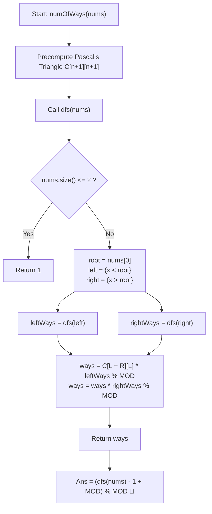

# 💡 Approach — Number of Ways to Reorder Array to Get Same BST

  | 📄 [Problem](./Problem.md) | 💡 [Approach](./Approach.md) | 🧩 [Solution](./Solution.cpp) | 🚀 [Main](./Main.cpp) |
  |:--------------------------:|:-----------------------------:|:------------------------------:|:---------------------:|

## 📊 Metadata

---

> [!TIP]
> **Core Intuition — BST Partitioning & Combinatorial Interleaving:**
> 1. **Root Assignment**:
>    Because an element is inserted into an initially empty subtree, the first element $root = nums[0]$ becomes the root node. It must precede all other elements in this subtree.
> 2. **Subtree Partitioning**:
>    Every subsequent element $x \in nums[1 \dots]$ is routed deterministically:
>    - $x < root \implies$ belongs to the left subtree $\mathcal{L}$.
>    - $x > root \implies$ belongs to the right subtree $\mathcal{R}$.
>    The relative order of elements within $\mathcal{L}$ and within $\mathcal{R}$ determines the recursive structure of each branch.
> 3. **Interleaving Independence**:
>    Elements destined for $\mathcal{L}$ and elements destined for $\mathcal{R}$ do not interact with one another during BST insertion. As long as the internal relative order of $\mathcal{L}$ is maintained, and the internal relative order of $\mathcal{R}$ is maintained, they can be arbitrarily interleaved.
> 4. **Binomial Multiplier**:
>    Choosing $|\mathcal{L}|$ positions out of $|\mathcal{L}| + |\mathcal{R}|$ total slots yields $\binom{|\mathcal{L}| + |\mathcal{R}|}{|\mathcal{L}|}$ distinct interleaving combinations.
> 5. **Global Answer**:
>    Compute recursively: $\text{ways}(nums) = \binom{|\mathcal{L}| + |\mathcal{R}|}{|\mathcal{L}|} \times \text{ways}(\mathcal{L}) \times \text{ways}(\mathcal{R}) \pmod{10^9 + 7}$.
>    Subtract $1$ at the end to exclude the original array configuration itself.

---

## 🔩 Step-by-Step Breakdown

### Method 1: Divide and Conquer with Pascal's Triangle ($\mathcal{O}(n^2)$ Time, $\mathcal{O}(n^2)$ Space) — Primary

1. **Precompute Combinations (Pascal's Triangle)**:
   - Construct a 2D table `C[n+1][n+1]` modulo $10^9 + 7$:
     $$C[i][0] = 1, \quad C[i][j] = (C[i - 1][j - 1] + C[i - 1][j]) \pmod{10^9 + 7}$$
   - This provides $\mathcal{O}(1)$ lookup for any binomial coefficient $\binom{n}{k}$.
2. **Recursive Helper Function (`dfs(arr)`)**:
   - **Base Cases**: If $arr.\text{size}() \le 2$, return $1$. (An array of size $\le 2$ has only $1$ valid insertion sequence that produces that subtree).
   - **Partitioning**:
     - Let $root = arr[0]$.
     - Filter $left = \{x \in arr \mid x < root\}$.
     - Filter $right = \{x \in arr \mid x > root\}$.
   - **Recursive Calls**:
     - $leftWays = dfs(left)$
     - $rightWays = dfs(right)$
   - **Interleaving Calculation**:
     - $L = left.\text{size}(), \quad R = right.\text{size}()$
     - $ways = (C[L + R][L] \times leftWays) \pmod{10^9 + 7}$
     - $ways = (ways \times rightWays) \pmod{10^9 + 7}$
     - Return $ways$.
3. **Subtract Original Permutation**:
   - The total number of valid permutations is $dfs(nums)$.
   - Return $(dfs(nums) - 1 + \text{MOD}) \pmod{\text{MOD}}$.

---

### Method 2: Combinatorics with Factorials & Fermat's Little Theorem ($\mathcal{O}(n^2)$ Time, $\mathcal{O}(n)$ Space) — Memory Optimized

Instead of maintaining a full $1000 \times 1000$ matrix, we can precompute factorials and modular inverse factorials:

1. **Precompute Factorials**:
   - $fact[i] = (fact[i - 1] \times i) \pmod{\text{MOD}}$
2. **Modular Inverse via Fermat**:
   - Since $10^9 + 7$ is prime:
     $$x^{-1} \equiv x^{\text{MOD} - 2} \pmod{\text{MOD}}$$
   - $\binom{n}{k} = fact[n] \times invFact[k] \times invFact[n - k] \pmod{\text{MOD}}$
3. **Space Reduction**:
   - Auxiliary space decreases from $\mathcal{O}(n^2)$ down to $\mathcal{O}(n)$ while retaining identical execution runtime.

---

### Method 3: Tree Construction & Hook-Length / Topological Sort Formula ($\mathcal{O}(n^2)$ Time, $\mathcal{O}(n)$ Space) — Structural View

1. **Explicit BST Construction**:
   - Insert elements sequentially into a pointer/indexed BST.
2. **Subtree Size Computation**:
   - For every node $u$, let $S(u)$ denote the total number of nodes in its subtree.
3. **Topological Sort Counting**:
   - The root must be inserted before all of its descendants. For a general tree/poset, the number of linear extensions (topological sorts) equals:
     $$\text{Total Ways} = \frac{n!}{\prod_{u} S(u)} \pmod{10^9 + 7}$$
   - Both methods produce identical combinatorial outcomes.

---

## 📐 Mathematical Derivation & Proof

### Why does $\binom{L + R}{L}$ count all valid interleavings?

Let array $L$ have length $|L|$ and array $R$ have length $|R|$.
We must create an array of length $|L| + |R|$ such that:
1. Every element of $L$ and $R$ appears exactly once.
2. If $u$ appears before $v$ in $L$, $u$ must appear before $v$ in the merged array.
3. If $p$ appears before $q$ in $R$, $p$ must appear before $q$ in the merged array.

Out of the $(|L| + |R|)$ empty slots in the merged array:
- Choose any $|L|$ slots to hold the elements of $L$. The number of ways to choose these indices is $\binom{|L| + |R|}{|L|}$.
- Once the $|L|$ slots are selected, the order of elements within those slots is uniquely forced by the order in $L$.
- The remaining $|R|$ slots are uniquely forced by the order in $R$.
- Thus, there are exactly $\binom{|L| + |R|}{|L|}$ ways to interleave the two subtrees.
- By the multiplication rule of combinatorics:
  $$\text{ways}(nums) = \binom{|L| + |R|}{|L|} \times \text{ways}(L) \times \text{ways}(R) \pmod{10^9 + 7} \quad \blacksquare$$

---

## 🔄 Mermaid Flowchart

---

## 🔍 Step-by-Step Trace Example

### Trace for `nums = [3, 4, 5, 1, 2]`:

1. **Level 0 (Root = 3)**:
   - Elements $< 3$: `left = [1, 2]` ($L = 2$)
   - Elements $> 3$: `right = [4, 5]` ($R = 2$)
   - Binomial coefficient: $\binom{2 + 2}{2} = \binom{4}{2} = 6$.
2. **Level 1 (Left Subtree: `[1, 2]`)**:
   - Size is $2 \le 2 \implies leftWays = 1$.
3. **Level 1 (Right Subtree: `[4, 5]`)**:
   - Size is $2 \le 2 \implies rightWays = 1$.
4. **Multiply**:
   - $\text{Total} = 6 \times 1 \times 1 = 6$.
5. **Exclude Original Array**:
   - $\text{Answer} = 6 - 1 = \mathbf{5}$.

The 5 alternate valid permutations are:
- `[3, 1, 2, 4, 5]`
- `[3, 1, 4, 2, 5]`
- `[3, 1, 4, 5, 2]`
- `[3, 4, 1, 2, 5]`
- `[3, 4, 1, 5, 2]`

---

## 📊 Complexity Analysis

| Complexity Metric | Estimation | Rationale |
| :---: | :---: | :--- |
| **Time Complexity** | $\mathcal{O}(n^2)$ | Precomputing Pascal's triangle takes $\frac{n(n+1)}{2} = \mathcal{O}(n^2)$ additions. Partitioning each array of size $k$ into left and right takes $\mathcal{O}(k)$ time. In the worst case (completely skewed BST), recursion tree depth is $n$, giving $\sum_{k=1}^n k = \mathcal{O}(n^2)$. In a balanced BST, recurrence is $T(n) = 2T(n/2) + \mathcal{O}(n) = \mathcal{O}(n \log n)$. |
| **Auxiliary Space** | $\mathcal{O}(n^2)$ | The combination matrix `comb[1001][1001]` uses $\approx 10^6 \times 8 \text{ bytes} \approx 8\text{ MB}$, well below memory limits. Recursion depth is $\mathcal{O}(n)$. (With Method 2, auxiliary space drops to $\mathcal{O}(n)$). |

---

> *"The shape of a tree is an enduring monument to its roots; countless paths may interweave through time, so long as ancestry is honored and heritage preserved."*

---

<h3>Happy Coding! 🚀</h3>

