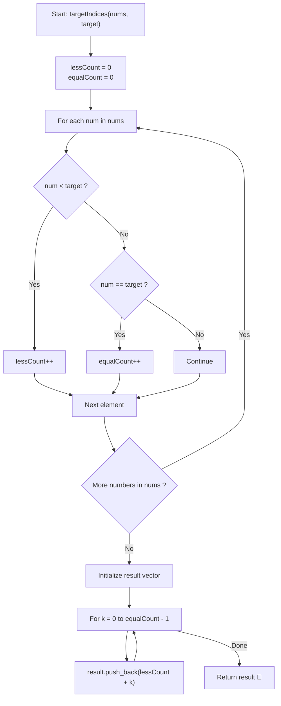

# 💡 Approach — Find Target Indices After Sorting Array

  | 📄 [Problem](./Problem.md) | 💡 [Approach](./Approach.md) | 🧩 [Solution](./Solution.cpp) | 🚀 [Main](./Main.cpp) |
  |:--------------------------:|:-----------------------------:|:------------------------------:|:---------------------:|

## 📊 Metadata

---

> [!TIP]
> **Core Intuition — The Counting Rank Invariant (Zero-Sort Solution):**
> 1. **Order Statistics Invariant**:
>    Sorting an array in non-decreasing order partitions its elements strictly by value. For any distinct value $v$, every element strictly smaller than $v$ must precede it in the sorted array.
> 2. **Starting Index Formula**:
>    Let $C_{<}(target)$ denote the number of elements in `nums` strictly less than `target`. In the sorted array, the elements smaller than `target` will exclusively occupy indices:
>    $$0, 1, 2, \dots, C_{<}(target) - 1$$
>    Consequently, the very first occurrence of `target` must reside at index $C_{<}(target)$.
> 3. **Contiguous Target Span**:
>    Let $C_{=}(target)$ denote the number of elements in `nums` equal to `target`. Because the array is sorted, all $C_{=}(target)$ elements are placed consecutively. The target indices are:
>    $$C_{<}(target), C_{<}(target) + 1, \dots, C_{<}(target) + C_{=}(target) - 1$$
> 4. **Linear Reduction**:
>    We do not need to sort the array! Both counts can be determined in a single $\mathcal{O}(n)$ pass with $\mathcal{O}(1)$ auxiliary memory.

---

## 🔩 Step-by-Step Breakdown

### Method 1: Optimal Counting / Rank Determination ($\mathcal{O}(n)$ Time, $\mathcal{O}(1)$ Space) — Primary

1. **Initialize Counters**:
   - `lessCount = 0`: tracks how many elements are $< target$.
   - `equalCount = 0`: tracks how many elements are $== target$.
2. **Single Linear Scan**:
   - For each number $x \in nums$:
     - If $x < target$, increment `lessCount++`.
     - Else if $x == target$, increment `equalCount++`.
3. **Construct Result Array**:
   - Initialize `vector<int> result`.
   - For $k = 0$ to $equalCount - 1$:
     - Append `lessCount + k` to `result`.
4. **Return**:
   - Return `result` (if `equalCount == 0`, `result` is empty automatically).

---

### Method 2: In-Place Sort with Linear Filtering ($\mathcal{O}(n \log n)$ Time, $\mathcal{O}(1)$ Auxiliary Space)

1. **Sort Array**:
   - Call `std::sort(nums.begin(), nums.end())`.
2. **Scan for Target**:
   - Iterate $i$ from $0$ to $n - 1$:
     - If `nums[i] == target`, push $i$ into `result`.
3. **Early Termination (Optional)**:
   - Since `nums` is sorted, if `nums[i] > target`, break immediately.
4. **Return**:
   - Return `result`.

---

### Method 3: In-Place Sort with Binary Search Bounds ($\mathcal{O}(n \log n)$ Time, $\mathcal{O}(1)$ Space)

1. **Sort Array**:
   - Call `std::sort(nums.begin(), nums.end())`.
2. **Find Target Range via Binary Search**:
   - `first = std::lower_bound(nums.begin(), nums.end(), target) - nums.begin()`
   - `last = std::upper_bound(nums.begin(), nums.end(), target) - nums.begin()`
3. **Populate Indices**:
   - For $i = first$ up to $last - 1$, push $i$ to `result`.
4. **Return**:
   - Return `result`.

---

## 📐 Mathematical Proof of Rank Invariance

Let $A = (a_0, a_1, \dots, a_{n-1})$ be the input array and $A' = (a'_0, a'_1, \dots, a'_{n-1})$ be its non-decreasing permutation such that:
$$a'_0 \le a'_1 \le a'_2 \le \dots \le a'_{n-1}$$

Define the counting functions on multiset $A$:
$$C_{<}(t) = |\{x \in A : x < t\}|, \quad C_{=}(t) = |\{x \in A : x = t\}|$$

Since $A'$ is a permutation of $A$:
1. Exactly $C_{<}(t)$ elements in $A'$ are strictly smaller than $t$.
2. Because $A'$ is sorted non-decreasingly, all elements strictly smaller than $t$ must occupy the prefix indices $\{0, 1, \dots, C_{<}(t) - 1\}$.
3. By the same non-decreasing property, no element $\ge t$ can appear at any index $< C_{<}(t)$.
4. If $C_{=}(t) > 0$, the elements equal to $t$ must immediately follow this prefix, occupying indices:
   $$\{C_{<}(t), C_{<}(t) + 1, \dots, C_{<}(t) + C_{=}(t) - 1\}$$
5. All elements strictly greater than $t$ occupy indices $\ge C_{<}(t) + C_{=}(t)$.

Thus, the set of indices where $a'_i = t$ is identically the contiguous interval $[C_{<}(t), C_{<}(t) + C_{=}(t) - 1]$. This proves that computing $C_{<}(t)$ and $C_{=}(t)$ is both necessary and sufficient to determine all target indices without sorting $A$. $\blacksquare$

---

## 🔄 Mermaid Flowchart

---

## 🔍 Step-by-Step Trace Example

### Trace for Example 1: `nums = [1, 2, 5, 2, 3]`, `target = 2` ($n = 5$)

| Step | Current Element `num` | Condition | Action | `lessCount` ($< 2$) | `equalCount` ($== 2$) |
| :---: | :---: | :---: | :---: | :---: | :---: |
| 1 | **1** | $1 < 2$ | `lessCount++` | 1 | 0 |
| 2 | **2** | $2 == 2$ | `equalCount++` | 1 | 1 |
| 3 | **5** | $5 > 2$ | Ignore | 1 | 1 |
| 4 | **2** | $2 == 2$ | `equalCount++` | 1 | 2 |
| 5 | **3** | $3 > 2$ | Ignore | 1 | 2 |

**Index Generation**:
- Starting Index = `lessCount` = **1**
- Number of Elements = `equalCount` = **2**
- Indices generated:
  - $k = 0 \implies 1 + 0 = \mathbf{1}$
  - $k = 1 \implies 1 + 1 = \mathbf{2}$
- Final Result: `[1, 2]`.

*(Verification via sorting: `[1, 2, 2, 3, 5]` $\implies$ indices of $2$ are indeed $1$ and $2$)*.

---

## 📊 Complexity Analysis

| Method | Time Complexity | Auxiliary Space | Key Advantage |
| :--- | :---: | :---: | :--- |
| **Method 1: Counting Rank (Optimal)** | $\mathcal{O}(n)$ | $\mathcal{O}(1)$ | Single pass, does not modify input, strictly linear time. |
| **Method 2: In-Place Sort + Scan** | $\mathcal{O}(n \log n)$ | $\mathcal{O}(1)$ / $\mathcal{O}(\log n)$ | Standard, intuitive, directly mirrors problem statement. |
| **Method 3: In-Place Sort + Binary Search** | $\mathcal{O}(n \log n)$ | $\mathcal{O}(1)$ / $\mathcal{O}(\log n)$ | Demonstrates logarithmic query bounds after sorting. |

---

> *"Knowing where a number belongs does not require ordering the universe, only counting those that stand before it."*

---

<h3>Happy Coding! 🚀</h3>

